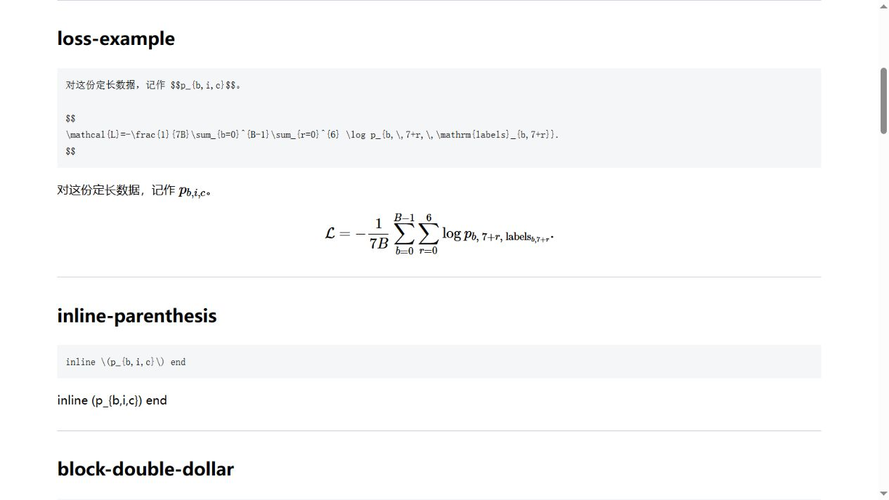
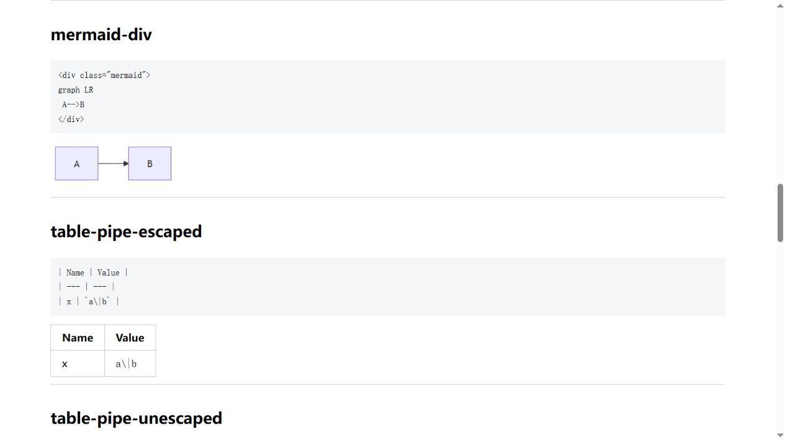

# 本站内容格式规范与渲染排错手册

核实日期：2026-10-31。适用于 `E:\kSource\blog` 的 Jekyll 博客；与 [AGENTS.md](../AGENTS.md) 配套。本文中的 Liquid 示例用于说明源码，不能直接复制到文章而忘记 `raw` 保护。

## 1. 先理解：一篇文章不是只经过 Markdown

本站实际处理顺序是：

```text
UTF-8 文件 + YAML front matter
    ↓
Liquid（变量、include、raw）
    ↓
kramdown / GFM（公式、表格、代码、HTML）
    ↓
Jekyll layout（按文章开关加入脚本）
    ↓
浏览器（MathJax、Mermaid、lazysizes、blog.js）
```

这解释了三种看起来相似、原因却不同的现象：

- 公式符号被 Markdown 提前吃掉：等多久也无法恢复，需要修改源码。
- 图片原图存在，但初始缩略图不存在：可能先出现 404，滚动进入视口后又加载成功。
- HTML 中已经有正确的公式或流程图源码，但客户端脚本还没执行或没加载：需要检查功能开关、网络和最终 DOM。

编辑器、GitHub Markdown、其他网站的 Mermaid 示例都不能替代本站验证。

以下是使用本站转换器和同版本脚本生成的隔离对照页截图，不是编辑器预览；页面刻意保留反例，方便比较：





### 实测版本与入口

| 部件 | 当前实测情况 | 仓库证据 |
| --- | --- | --- |
| Ruby | 2.5.8，本机安装不在默认 PATH | 本机解释器版本 |
| Jekyll | 3.9.0，Gemfile 使用 github-pages 207 | [Gemfile](../Gemfile)、Gemfile.lock |
| Markdown | kramdown 2.3.0，`input: GFM` | [_config.yml](../_config.yml) |
| 代码着色 | Rouge | `_config.yml`、Gemfile.lock |
| 数学 | MathJax 2.7.5 + 本地配置 | [_includes/mathjax.html](../_includes/mathjax.html)、[assets/mathjax.js](../assets/mathjax.js) |
| Mermaid | 仓库内 `mermaid.min.js`，不假定与在线最新版相同 | [_layouts/post.html](../_layouts/post.html) |
| flowchart.js | 独立于 Mermaid 的旧流程图方案 | `_layouts/post.html` |
| 图片懒加载 | lazysizes，依赖 `data-src` / `lazyload` | [_includes/head.html](../_includes/head.html)、[_includes/image.html](../_includes/image.html) |
| 自定义页面处理 | 表格宽度、图表隐藏等 | [assets/blog.js](../assets/blog.js) |

当前本地配置 `baseurl: "/blog"`，根域部署也可能使用空前缀。因此应让模板计算站内路径，而不是把当前主机或前缀写死。

## 2. 文件与 front matter

新文章建议：`_posts/分类/YYYY-MM-DD-slug.md`，UTF-8 编码，顶部从第一行开始写 YAML。例子：

```yaml
---
layout: post
title: "从零理解 Transformer"
categories: ["大语言模型"]
tags: ["Transformer", "注意力"]
toc: true
mathjax: true
mermaid: true
flowchart: false
---
```

- `true` 是布尔值，`"true"` 是字符串。本模板的 Mermaid/flowchart 条件是严格比较 `== true`，字符串会导致脚本不加载。
- MathJax 的模板条件是一般真值判断，`"false"` 这种非空字符串反而可能启用脚本。统一使用布尔值可以避免两种开关行为不一致。
- `visibility: hidden` 是本站识别的隐藏标记；不要写 `hide`。隐藏不等于秘密存储，资源和页面仍可能被构建。
- 有 `date` 时，Jekyll 可以使用它决定文章时间，不要只凭文件名判断实际 URL。
- `_posts` 只放文章。带日期的 JSON 缓存也可能进入文章集合；本次确实发现了一个这样的文件。
- 禁止不可见控制字符。普通换行、回车和制表符与 NUL、退格、换页不同，不能混在一起处理。

## 3. 数学公式：源文件与最终 HTML 的分隔符不同

### 3.1 推荐写法

行内公式在 **Markdown 源码**中使用双美元：

```markdown
记作 $$p_{b,i,c}$$，表示样本 b、位置 i 预测类别 c 的概率。
```

本机 kramdown 会输出 `\(p_{b,i,c}\)`；MathJax 再把它排成行内公式。源码中的 `$$` 在这里并不意味着强制显示为独立大公式。

块公式把分隔符放在独立行，并留空行：

```markdown
平均交叉熵为：

$$
\mathcal{L}=-\frac{1}{7B}\sum_{b=0}^{B-1}\sum_{r=0}^{6}
\log p_{b,\,7+r,\,\mathrm{labels}_{b,7+r}}.
$$

这里的概率沿输出类别归一化。
```

这会被转换成显示公式所用的 `\[...\]`。检查生成 HTML 时看见这些分隔符是正常的中间状态。

这条 loss 公式的前提是每个样本只监督六个答案数字和一个 EOS，共七个目标位置，索引为 7–13；其他任务不能直接照搬 `7B`。概率 softmax 沿类别维，注意力 softmax 沿 key 位置维，排版正确不代表可以混淆数学含义。

### 3.2 已用本站转换器验证的对照

| Markdown 源码 | 实际中间 HTML / 结果 | 结论 |
| --- | --- | --- |
| `inline $$p_{b,i,c}$$ end` | `inline \(p_{b,i,c}\) end` | 推荐的行内写法 |
| 独立行的 `$$` 数学块 | `\[...\]` | 推荐的块写法 |
| `inline \(p_{b,i,c}\) end` | 反斜杠被消耗，变成普通括号 | 不直接作为源码分隔符 |
| 原始 `\[` / `\]` 数学块 | 可能成为普通方括号段落 | 不直接作为源码分隔符 |
| `$a*b*c$` | 中间的 `b` 可能先变成 `<em>b</em>` | 单美元并不保护 Markdown 内容 |

历史文章中的 `$x$` 常能成功：本地 MathJax 配置仍支持单美元。但 Markdown 会先运行，复杂公式可能已经被改写。因此新内容统一使用 kramdown 的双美元写法，旧内容逐处验证后再改，不全库机械替换。

### 3.3 公式与其他语法相遇

- 开启 `mathjax: true`。放在 `pre`、`code`、`script`、`textarea` 等标签里的数学不会由本站 MathJax 扫描；这正适合展示源码，但不适合期待排版的正文公式。
- TeX 中的 `_`、`*`、反斜杠等要由公式边界保护；矩阵中的换行使用 TeX 的 `\\`。
- 表格公式的绝对值写 `\lvert x\rvert`，范数写 `\lVert x\rVert`，不要用原始 ASCII 竖线。详见表格章节。
- 连续的 `{{` 可能先被 Liquid 解释，不能因为它位于公式或围栏中就假定安全；必要时用 TeX 等价写法留空格，或对字面示例加 raw 保护。
- 显示金额、shell `$变量`、qmake `$$PWD` 时使用代码标记或合适的转义，不当成数学。`\[1\]` 也可能只是转义后的参考序号，不能一见反斜杠就判定公式损坏。
- 本站支持的 `\R`、`\N`、`\vect`、`\norm` 等宏由 `assets/mathjax.js` 定义，不是所有平台的通用宏；迁移文章时要检查。
- AMS 自动编号已启用。长公式可用兼容 MathJax 2 的 `aligned` 等环境，不依靠空格实现对齐。

### 3.4 Python 生成文章时的转义

```python
formula = r"\frac{1}{7B}\sum_{b=0}^{B-1}p_b"
```

不要在普通 Python 字符串中随意写 `"\frac"`、`"\begin"`、`"\text"`：其中的 `\f`、`\b`、`\t` 有字符串转义含义。`json.dumps` 只能负责 JSON 编码，不能替你修复已经生成的错误字符串。

验收应检查最终 `.md` 的字节、生成 HTML 和浏览器排版三个层次；公式出现 `Math Processing Error` 或 merror 时要读取具体错误，不能只清缓存。

## 4. 图片：原图、缩略图与路径是三个检查点

### 4.1 新图优先用已有 include

```liquid
{% include image.html
   url="/assets/images/261031-transformer-from-scratch/baseline_loss.png"
   caption="完整模型的训练与验证 loss"
   nolazyload=true
   style="max-width:100%;height:auto;" %}
```

`image.html` 会添加 `site.baseurl`，所以参数传 `/assets/...`，不要传 `/blog/assets/...`。这个模板不区分远程 URL，非空 baseurl 会被拼到 `https://...` 前面；远程图片应使用普通 Markdown 或原生 HTML。

默认行为与显式参数的差别：

| 写法 | 初始 src | 后续动作 |
| --- | --- | --- |
| 不写 `nolazyload` | 原路径追加 `.thumbnail.webp` | lazysizes 把 `data-src` 原图切入 |
| `nolazyload=true` | 原图路径 | 不依赖缩略图和这次懒加载 |
| `nolazyload=false` | 仍是原图路径 | 当前模板只检查 null，false 也算已传参 |

例如原图 `loss.png` 的缩略图名是 `loss.png.thumbnail.webp`，不是 `loss.thumbnail.webp`。如果原图和缩略图不齐全，可直接加载原图，不必为了一张图运行全站资源转换脚本。

常用参数为 `url`、`caption`、`width`、`height`、`style`、`align`、`noshadow`、`divstyle`，以及第二、三张图相应的 `url2` / `caption2` / `style2` 等。以模板实际读取的参数为准。

**该 include 没有输出 alt 属性的逻辑。** 需要替代文本时可写：

```html

```

这是有意执行 Liquid 的属性，不要用 raw 把它保护掉；只有文章中展示这段源码时才需要 raw。

### 4.2 其他图片入口与远程图片

- `image1.html`、`image2.html` 等为历史样式变体，不默认等同于 `image.html`；使用前读取模板。
- `imagecdn.html` 可以按 `page.kaliyun` 切换 CDN，也仍有 baseurl、缩略图和参数规则；不能凭文件名认定它接受任意绝对 URL。
- `imagek` 等历史入口可能包含内网地址，不作为新公开文章的默认方案。
- 远程图片示例：``。外站可用性、防盗链、混合内容和隐私需要单独考虑，本地存在性检查无法证明远程图可访问。
- 选择浏览器能解码的图片格式；原图不损坏，尺寸和比例正确。透明图、动画、SVG 各有用途，不因为资源整理而无差别转换。

### 4.3 图片验收

1. 源文件真实存在，扩展名和大小写一致。
2. 生成 HTML 的 `src` / `data-src` 前缀正确，没有双 `/blog` 或 `/bloghttps://`。
3. 懒加载图进入视口后可见；必要时查看最终 `naturalWidth > 0`。
4. 点击原图/下载链接也能打开，不能只检查文章里的缩略图。
5. 图中坐标、图注、正文引用一致，重要文字在移动端仍可辨认。

图片加载正常和图表科学含义正确是两项不同的验收。

## 5. 流程图、时序图与旧 flowchart.js

### 5.1 本站 Mermaid 的标准写法

front matter：`mermaid: true`。

```html
<div class="mermaid">
graph LR
    A["输入 token"] --> B["词嵌入与位置编码"]
    B --> C["因果自注意力"]
    C --> D["预测下一个 token"]
</div>
```

- 容器及图前后留空行，不放进代码围栏，不给容器加 `markdown="1"`。
- 复杂节点文字用双引号；节点 ID 使用简单的英文字母/数字组合，避免把特殊字符作为 ID。
- kramdown 可能把箭头写成 `--&gt;`，浏览器读取 textContent 后仍是 `-->`，不必把正常转义当成故障。
- 本站 layout 调用 `mermaid.initialize({startOnLoad:true})`。验收看容器内是否出现 SVG，并检查文字、箭头和阅读顺序。
- 通用 `mermaid` 围栏会产生 `code.language-mermaid`；当前站点没有把它转换成 `.mermaid` 容器的步骤，因此不作为可自动出图的标准格式。
- `?nochart=1` 会触发 `blog.js` 删除 Mermaid 容器/代码。排错时先去掉此参数。`?svgdl=1` 是辅助导出入口，不是渲染开关。
- `sequenceDiagram` 等其他图型也放在相同容器中，但须以当前 bundle 实测支持为准。在线最新版能渲染，不代表本站旧 bundle 一定支持。
- 只有为了**展示图的源码**才使用围栏；不要把“代码示例没有变成图”误判为文章缺图。

### 5.2 flowchart.js 是另一种语言

front matter：`flowchart: true`，源码用 `flow` 围栏，例如：

````markdown
```flow
st=>start: 开始
op=>operation: 执行实验
en=>end: 完成
st->op->en
```
````

layout 会载入 Raphael / flowchart.js，再处理 `.language-flow`。Mermaid 的 `graph LR` 不能直接交给它；`flowchart: true` 也不会启用 Mermaid。

## 6. 表格：先保证分列，再处理公式与宽度

### 6.1 普通表格

```markdown
| 模型 | 参数量 | 整序列准确率 |
| --- | ---: | ---: |
| 完整模型 | 记录实测值 | 记录实测值 |
```

表格上下留空行，每行列数与表头、分隔行一致。对齐用 `:---`、`---:`、`:---:`，不要用空格凑视觉对齐。没有数值时写清“未测”，不要编造占位数值。

### 6.2 四种竖线不是同一种情况

| 所在上下文 | 建议源码 | 本机转换器行为 |
| --- | --- | --- |
| 普通文本单元格 | `a\|b` | 一列内显示 `a|b` |
| 代码跨度 | `` `a|b` `` | 本版本保持一列 |
| 给代码跨度机械加转义 | `` `a\|b` `` | 反斜杠也可能显示出来 |
| 数学单元格 | `$$\lvert x\rvert$$` | 数学保护与分列都清晰 |

`$$|x|$$` 在本站实测会被拆成额外列；双美元不是表格解析器的竖线转义。不要全局把所有 `|` 替换成 `\|`，这会同时损伤表格边界和代码。

### 6.3 宽表和自定义宽度

本地 `blog.js` 识别这样的控制表格：

```html
<table class="tablestyle" ntablew="2:3:5" tablew="100%"></table>
```

它会被移除，并把比例应用到紧接着的下一张表。它是有意存在的空表，不要作为垃圾表格删掉。比例项数量应与目标表格列数一致。

长公式、多行代码或大量文本不适合挤进小单元格。优先拆分段落或改用显式 HTML 表格；不要依赖 Markdown 单元格内直接嵌套复杂块。浏览器检查表头是否对应数据、是否截断、窄屏能否阅读。

## 7. 代码、Liquid、HTML 和特殊 token

### 7.1 Liquid 比代码着色更早执行

在文章中展示 `{{ site.baseurl }}` 或 ``，即使放进三反引号围栏，Liquid 也可能先执行。应把整个示例包住：

````text

```liquid

```

````

只保护**要展示的字面源码**，不要保护本来就要执行的图片 include。Jekyll 文档中 `render_with_liquid: false` 是较新版本选项，不适用于当前 Jekyll 3.9。

围栏注明语言，例如 `python`、`bash`、`json`、`yaml`、`cpp`；外层展示围栏时使用四个或更多反引号。代码应可复制，不把提示符、行号、智能引号和省略号混进可执行片段。

### 7.2 尖括号必须说明是文字还是标签

正文中的 `<EOS>`、`<BOS>`、`<filename>`、`std::shared_ptr<Widget>` 可能被当成 HTML，甚至改变后续 Markdown 的解析边界。使用：

```markdown
模型遇到 `<EOS>` 后结束；命令中的 `<filename>` 需要替换成实际文件名。
```

或用 `&lt;EOS&gt;`。如果前面已有一个裸标签破坏解析，不能指望后面的反引号补救，应该从第一个裸 token 开始修正。

### 7.3 HTML 容器中的 Markdown

```html
<div markdown="1">

**这段文字需要由 Markdown 解析。**

</div>
```

不带 `markdown="1"` 的原生块级 HTML 中，Markdown 可能保持字面源码。对 Mermaid、脚本和原生 HTML 表格则按各自语言编写，不混入期待自动解析的 Markdown。

## 8. 链接、锚点、下载和媒体

### 8.1 站内路径

```liquid
[下载结果 CSV]()
[查看原图]({{ '/assets/images/example/chart.png' | relative_url }})
```

`relref.html` 添加 baseurl；`relative_url` 也用于处理站内前缀。不要再手动拼 `/blog`。下载链接不能指向 `C:\...`、`E:\...` 或仅本人有效的临时目录。

跨文章链接可使用当前版本支持的 Jekyll `post_url`，但先核对实际文件与输出 URL；不要凭标题臆造 slug。文章中显式 id 不重复，目录与锚点跳转在最终 HTML 中验证，尤其是中文、标点和重复标题。

### 8.2 视频、PDF、音频与 iframe

- `video.html` 对参数 `url` 自动追加 `.264.mp4`，再添加 baseurl。传入已有 `.mp4` 路径可能造成重复后缀；使用前检查实际生成 src 和文件名。
- 原生 `<video>` / `<audio>` 提供正确的 `source` 类型、用户可控的播放方式与说明。不能把自动播放是否成功当作文件是否存在的唯一依据。
- `embedvideo.html`、`embedpdf.html` 等必须读取模板规则。当前 PDF 模板使用 HTTP Google viewer，HTTPS 页面可能因混合内容而阻止加载；外部 viewer 也需要能从公网访问文件。不要用它嵌入私密或仅本机可访问的文件。
- 外部 iframe 还可能被对方的嵌入策略阻止。提供可理解的标题和备用链接，避免页面只剩空白框。
- HTTP 远程资源、过期链接、防盗链和第三方服务故障需网络复核；本次静态检查不承诺外站全部可用。

## 9. 文章结构与可读性

- 标题按层级递进；本模板已显示文章标题，正文从合适的二级标题开始，避免重复堆砌一级标题。
- 标题后、段落与列表之间留空行，嵌套列表缩进一致；序号列表中的代码块归属正确。
- 引用用 `>`，注明来源和链接；脚注可用 kramdown 的 `[^id]` / `[^id]: 内容`，id 不重复，并实际检查跳转。
- 分隔线 `---` 前后留空行，避免和 YAML 或 Setext 标题混淆。
- 图片、表格、公式、代码在正文中有引入和解释。图号、表号、坐标、单位、颜色含义及样本范围要对应。
- 不把示意图当实测图，不把占位表当实验结果，不为改善排版修改真实实验数据。
- 中文正文尽量用清楚的短段落；数学符号先定义，代码形状和索引与公式对应。排版审计只能发现其中一部分问题，学术内容还要人工复核。

## 10. 推荐检查流程

### 10.1 只读批量检查

仓库根目录执行：

```powershell
& 'C:\Ruby25-x64\bin\ruby.exe' -EUTF-8 tools/render_post_formats.rb
python tools/audit_post_formats.py
python tools/test_audit_post_formats.py
```

解释器不在 PATH 时使用实际完整路径；不为格式检查重装依赖或升级 Gem。Ruby 工具使用当前安装的 Jekyll，对所有文章运行实际 Liquid、Markdown、layout 渲染，同时纳入 future / unpublished 文章，**不执行整站 write、静态资源复制或发布**。结果默认在 `tempdir/format-audit/`。

Python 工具读取源码和上述 HTML，核对源文件哈希，输出：

| 文件 | 用途 |
| --- | --- |
| `render-results.json` | 每个 Jekyll 文档的渲染结果、版本、开关、源码哈希与格式对照样例 |
| `rendered/` | 每篇文章的实际 HTML，临时产物 |
| `fixtures.html` | 可供浏览器验证的正反例，使用本站版本与本地脚本 |
| `audit.json` | 汇总、逐篇清单、全部发现 |
| `inventory.csv` | 每篇文章的覆盖情况、特征计数与 SHA-256 |
| `findings.csv` | 路径、行号、级别、规则与说明 |

`python tools/audit_post_formats.py --fail-on-error` 发现 error 时返回非零；默认命令只报告结果。未先渲染时会提示 `NOT_RENDERED`；修改源文后必须重新渲染，否则有 `STALE_RENDER` 风险。

检测范围与边界：

- 检查 YAML 边界/部分开关、实际渲染异常、代码围栏、控制字符、表格分列候选、数学/图表开关、include 存在性、正文资源存在性和大小写、重复显式 id 等。
- 代码、注释和 raw 示例尽量排除，但静态语法识别不是完整的 Markdown/Liquid 语义分析器。`warning` 必须结合上下文复核，`info` 只是兼容性提示。
- 相对资源、动态 URL、页面 permalink、外部网址及脚本运行后才生成的内容不能仅靠文件存在性检查下结论。表格和公式数量也是规则提取结果，不是数学对象的语义计数。
- 不验证所有链接锚点、所有浏览器布局、外链状态、TeX 推导、代码执行结果或图表统计结论；需要在修改范围内补充针对性检查。

### 10.2 浏览器验证

可以使用现有正常构建的本地站点，或把生成的对照页通过 HTTP 服务打开。当前 `baseurl: /blog`，在 `E:\kSource` 提供服务时，路径是 `/blog/tempdir/format-audit/fixtures.html`。使用 loopback 地址，不需要发布到公网。

例如在另一个终端执行以下命令，再打开 `http://127.0.0.1:8769/blog/tempdir/format-audit/fixtures.html`；检查结束后用 Ctrl+C 停止这个临时服务。

```powershell
python -m http.server 8769 --bind 127.0.0.1 --directory E:\kSource
```

先看正例，再看反例；等待客户端脚本完成。浏览器验收包括：

1. 行内与块公式真正排版，无 MathJax 错误；例子中故意错误的 raw 分隔符不应误当正例。
2. `.mermaid` 中生成 SVG，而围栏仍为代码；文字和箭头方向正确。
3. 图片原图实际加载，懒加载图滚动进入视口后正常；原图/附件链接可打开。
4. 表头与数据列对应，数学竖线没有产生多余列；HTML 容器内的 Markdown 按预期解析。
5. 桌面和窄屏可读，代码/宽表可滚动，锚点与媒体有实际可用反馈。

### 10.3 安全修复边界

不要为了“检查”运行旧批量格式化流程。`checkall.py`、`headfmt.py`、`mdformat.py`、`mdrstrip.py`、`jekyllserv.py` 及其插件包含改写文章、改配置、复制或清理资源等操作，不是只读 linter。

先保存现状、限定文件、做小 diff，再重新渲染。对缺失文件寻找原始来源；对无法理解的控制字符保留证据并人工核对，不猜数字。不要全站替换美元、反斜杠、竖线或 HTML 标签。

本次全站核实结果、修正范围、尚待处理项和 285 篇逐篇覆盖清单见 [审计报告](format-audit-2026-10-31.md)。

## 11. 常见现象与定位顺序

| 现象 | 优先检查 |
| --- | --- |
| 公式变成普通括号 | 源码是否直接使用了反斜杠分隔符；查看 kramdown 中间 HTML |
| 公式一直显示源码 | `mathjax` 类型、MathJax CDN/本地配置是否加载、内容是否在 code/pre 中 |
| 公式某部分斜体或丢符号 | 单美元中的 Markdown 先被解析；改成受保护的公式写法再验证 |
| 图先空白后出现 | 缩略图是否缺失、原图是否在 data-src、lazysizes 是否生效 |
| 本地能看，Linux 缺图 | 大小写、baseurl、资源是否真正被跟踪和部署 |
| 图片正常但原图/附件 404 | 原图/下载链接是否绕过 baseurl |
| Mermaid 显示源码 | 开关是否为布尔 true、容器是否正确、bundle 是否支持该语法 |
| Mermaid 整块消失 | URL 是否带 `nochart` 参数，是否被本站脚本删除 |
| 表格多出空列 | 表头/分隔行列数、公式或文本中的裸竖线 |
| 示例代码被替换或构建报 Liquid 错误 | 字面 Liquid 是否有 raw 保护；围栏不能阻止 Liquid |
| 正文突然吞掉后续内容 | 裸尖括号 token、未闭合 HTML/围栏、HTML 块中的 Markdown |

## 12. 参考依据

仓库当前源码与实测结果优先于通用建议。外部文档用于解释原理，版本不同时要回到本机对照样例：

- [kramdown 语法：数学、表格、HTML、脚注](https://kramdown.gettalong.org/syntax.html)。在线文档版本可能高于本站 2.3.0。
- [Jekyll Liquid tags](https://jekyllrb.com/docs/liquid/tags/)。注意 `render_with_liquid` 的版本标记。
- [Jekyll filters：relative_url 等](https://jekyllrb.com/docs/liquid/filters/)。
- [MathJax 2.7 文档](https://docs.mathjax.org/en/v2.7-latest/)。不能照搬 MathJax 3/4 配置对象。
- [Mermaid 官方用法](https://mermaid.js.org/config/usage.html)。图型与语法仍要在仓库 bundle 上验证。
- [lazysizes 项目](https://github.com/aFarkas/lazysizes)。本站初始缩略图规则由自己的 include 决定。
