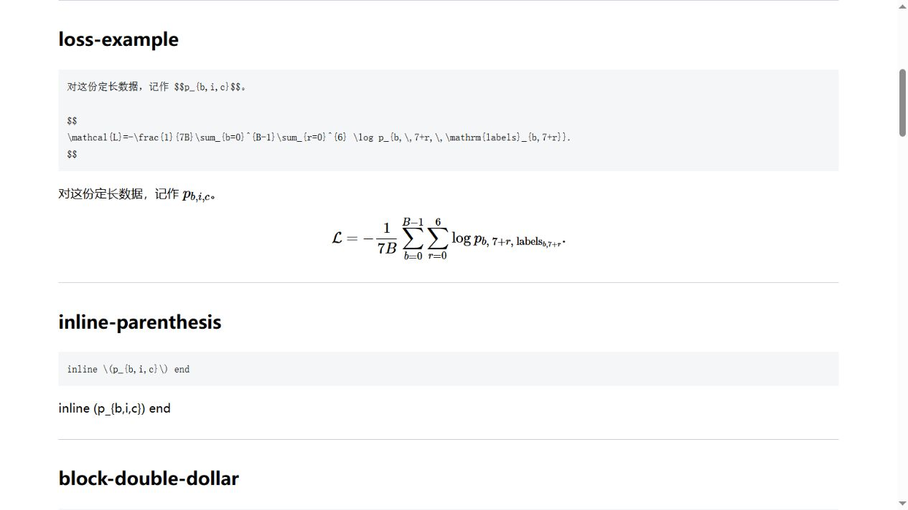
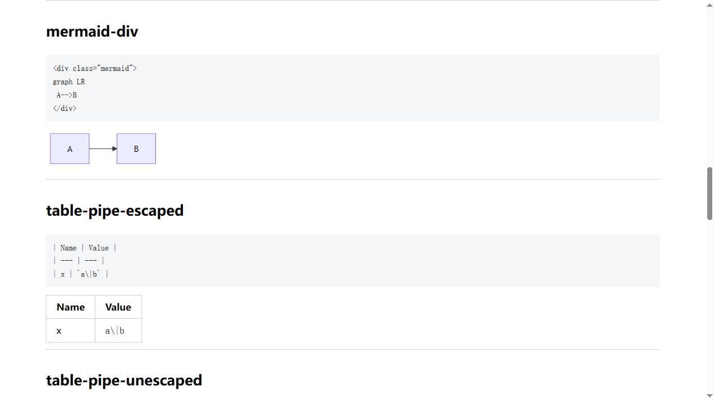

# 全站文章格式审计：2026-10-31

本次核实覆盖 `_posts` 下全部 **285 篇 Markdown**，逐篇执行当前安装的 Jekyll 的 Liquid、Markdown 与 layout 渲染，并检查源码和生成 HTML。另有 3 个 JSON 辅助文件，其中 1 个被 Jekyll 识别为文章，故实际文章集合为 286 个文档。

修正了 **8 篇文章**中能够确定的格式问题。复查后 285 篇均成功渲染，**没有渲染引擎异常**；仍有 **5 条确定的源码/资源问题**，以及 **58 条需结合上下文确认的 warning**。不能据此宣称全站没有问题。

格式规则及可直接参考的写法见 [完整手册](content-formatting.md)，后续约束见 [AGENTS.md](../AGENTS.md)。

## 1. 证据、环境与检查边界

| 项目 | 本次记录 |
| --- | --- |
| 文章范围 | `_posts` 全部 `.md` / `.markdown`，不按日期或文件名猜测性排除 |
| 实际渲染 | Jekyll 3.9.0，kramdown 2.3.0 / GFM，Ruby 2.5.8 |
| 本次路径前缀 | `/blog`；不改动原有部署配置 |
| 纳入状态 | 包含 future / unpublished；不是只检查当前首页展示的文章 |
| 检测对象 | 源文、部分 front matter、实际生成 HTML、正文引用资源、格式对照样例 |
| 校验 | 每篇保存 SHA-256，最终渲染记录与源文一致，无 STALE_RENDER |
| 浏览器 | 本地 HTTP 服务，实际 MathJax 2.7.5、本站 Mermaid bundle 与配置；抽查正反例及 Transformer 全文 |
| 未执行 | Colab 操作、训练、整站 write/资源复制、批量旧格式化脚本、发布 |

这是一份**格式与渲染审计**。没有逐篇执行历史代码、验证全部数学推导、打开全部浏览器页面或爬取所有外链。普通相对资源、动态地址、页面 permalink、运行后生成的内容和所有锚点也不都能由存在性扫描判定。文章的学术正确性、外站可用性和移动端布局仍需按修改范围人工复查。

### 完整机器记录

- [逐篇清单 CSV](format-audit-2026-10-31-inventory.csv)：285 行，含状态、特征计数和源码 SHA-256。
- [全部发现 CSV](format-audit-2026-10-31-findings.csv)：路径、行号、级别、规则和解释，可按规则或文件过滤。
- [完整 JSON](format-audit-2026-10-31.json)：版本、汇总、逐篇特征、所有发现。
- [浏览器检查记录](format-audit-2026-10-31-browser-checks.json)：正反例与 Transformer 全文的 DOM 检查。

CSV 使用 UTF-8 BOM 便于 Windows 查看。行号对应本次最终源文件；后续修改可能使行号变化。临时渲染 HTML 留在被忽略的 `tempdir/format-audit/`，不作为正式资源发布。

## 2. 本次修正了什么

| 文章 | 确认的问题 | 修正 |
| --- | --- | --- |
| [吴恩达深度学习笔记](../_posts/deep/2022-10-11-ml-DL-Andrew-Ng.md) | 正文公式存在，MathJax 开关为空 | 设置 `mathjax: true` |
| [正态分布与 π](../_posts/math/2023-08-13-Normal-distribution-and-PI.md) | 行内双美元公式存在，MathJax 开关为空 | 设置 `mathjax: true` |
| [李沐深度学习笔记](../_posts/deep/2024-07-09-ml-DL-limu.md) | 13 张表的四列表头配了五列分隔行 | 只删除分隔行多余列，保留所有数据行 |
| [skimage 笔记](../_posts/dip/2020-10-04-dip-skimage.md) | 两列表格配了三列分隔行 | 只修正该分隔行，不改另一张正常的三列表 |
| [人工智能数学基础](../_posts/study/2025-10-25-Mathematical-Fundamentals-of-Artificial-Intelligence.md) | 范数表有空列和公式分列问题 | 整理为名称/记号/定义/含义四列，公式用双美元与 `lvert` 等命令 |
| [Irrlicht 分析](../_posts/irrlicht/2021-01-04-irrlicht-analyze.md) | 原图路径大小写与实际文件不一致 | 使用实际文件名并直接加载原图，避免引用不对应的缩略图 |
| [线性代数笔记](../_posts/math/2022-08-23-Linear-Algebraic.md) | 两张 AVIF 原图存在，默认缩略图不存在 | 两处添加 `nolazyload=true` |
| [手写 Transformer](../_posts/llm/2026-10-31-transformer-from-scratch.md) | 10 个下载/原尺寸图链接绕过 baseurl | 使用已有 `relref.html`，生成 `/blog/assets/...` |

没有修改实验 notebook、训练数据、结果表或图片文件，也没有批量替换历史单美元公式。`jekyllserv.py` 中原有的未提交改动保留原样，不属于本次修改。

## 3. 仍需处理的确定问题：5 条，涉及 4 篇文章

| 源文件与行号 | 问题 | 后续处理建议 |
| --- | --- | --- |
| [_posts/irrlicht/2021-03-16-shader-OpenGL-research.md:56](../_posts/irrlicht/2021-03-16-shader-OpenGL-research.md) | `glColorMask` 示例参数含 U+0001 控制字符 | 对照原始代码/资料确认布尔值，不能猜测替换 |
| [同文件:73](../_posts/irrlicht/2021-03-16-shader-OpenGL-research.md) | `flag` 参数含 U+0001 控制字符 | 确认原意后修复并运行/核对相关示例 |
| [_posts/note/other/2026-08-31-compattelrunner.md:179](../_posts/note/other/2026-08-31-compattelrunner.md) | 缺少 `/assets/reviewjs/blogs/2026-08-31-compattelrunner.md.js` | 核对 reviewjs 的真实生成流程及该功能是否仍需保留 |
| [_posts/study/2026-08-29-English-Grammar-From-Zero.md:590](../_posts/study/2026-08-29-English-Grammar-From-Zero.md) | 缺少 `/assets/reviewjs/blogs/2026-08-29-English-Grammar-From-Zero.md.js` | 找回/正确生成资源，或确认设计后移除无用引用 |
| [_posts/study/2026-10-10-wordtap-technical-english.md:124](../_posts/study/2026-10-10-wordtap-technical-english.md) | 缺少 `/assets/reviewjs/blogs/2026-10-10-wordtap-technical-english.md.js` | 同上，不用空文件掩盖资源缺失 |

三处脚本缺失不等于整篇文章无法显示，但相应功能可能不可用。控制字符问题也不等于 Jekyll 必然报错：引擎可以成功输出有问题的内容。

## 4. warning 与 info 怎么读

### warning：58 条

| 规则 | 条数 | 解释 |
| --- | ---: | --- |
| `LIQUID_IN_CODE` | 41 | 涉及 16 个文件；代码中的 Liquid 可能是有意执行，也可能缺少 raw 保护，需对照源码与最终展示 |
| `RAW_SPECIAL_TOKEN` | 15 | 涉及 8 个文件；裸尖括号 token / C++ 模板 / 命令占位符可能被 HTML 消费，不能机械替换所有标签 |
| `VISIBILITY_VALUE` | 1 | `2025-08-07-document-image-reconstruction-evaluation.md` 使用 `hide`，不是模板识别的 `hidden`；需要确认可见性意图 |
| `NON_MARKDOWN_POST` | 1 | `2024-09-24-how-to-run-qwen-using-ollama.spacefix.json` 被识别为文章，辅助缓存应核对移出 `_posts` 的方案 |

另两个 `k2022-05-08-kaoyu-menu-*.spacefix.json` 本次没有进入文章集合，但也不应作为新文章的存储示范。历史特殊文件名不能只靠正则判断是否渲染，要以 Jekyll 的实际记录为准。

### info：691 条

- `INLINE_DOLLAR_LEGACY`：690 条**按源码行去重的提示**，不是“690 个坏公式”。单美元在本站仍可工作，但复杂内容可能先被 Markdown 改写。它们没有被一键替换。
- `DOLLAR_VARIABLE_LITERAL`：1 条 qmake 风格 `$$` 变量提示，不能当成未闭合公式。

普通数组的 `\[0\]`、参考序号、Windows 链接中的转义括号已从明显的数学分隔符候选中区分；这类语法不能单凭一个反斜杠就判断错误。

最终没有再发现本规则覆盖范围内的表格列数不一致、缺 MathJax/Mermaid 开关、资源路径大小写、缩略图缺失、裸 baseurl 资源链接、未闭合围栏或渲染快照过期记录。此结论受检测规则边界限制，不能泛化成所有表格/公式都已人工逐个证明无误。

## 5. 浏览器实际验证

对照页由同一个 kramdown 转换器生成，使用本站 MathJax 配置和 Mermaid bundle。没有使用通用 Markdown 预览代替。

| 场景 | 浏览器结果 |
| --- | --- |
| 行内 `$$p_{b,i,c}$$` | 正常排版 |
| 七个监督目标的交叉熵数学块 | 正常排版，无 MathJax 错误 |
| 原始反斜杠数学分隔符 | 成为普通括号/方括号文本，证实不适合作为本站标准源码格式 |
| 单美元 `$a*b*c$` | Markdown 先产生强调，未得到预期完整公式 |
| `.mermaid` 容器 | 生成 SVG |
| `mermaid` 围栏 | 保持代码，没有生成 SVG |
| 表格代码跨度 `a|b` | 保留两列 |
| 给代码跨度写 `a\|b` | 保留两列，但反斜杠也显示出来 |
| 表格数学 `$$|x|$$` | 错误地变成四列 |
| 表格数学 `$$\lvert x\rvert$$` | 两列正常，公式正常排版 |
| 裸 `<EOS>` | HTML 解析消费 token，并影响后续字面展示 |
| `markdown="1"` HTML 容器 | 内部 Markdown 加粗正常；普通 div 中示例保持字面星号 |
| 原图直接加载 | 成功，`naturalWidth = 2000` |





还打开了 **Transformer 文章实际生成的完整 HTML**：11 个公式源码节点对应 11 个 MathJax 排版对象，错误节点为 0；流程图生成 1 个 SVG；五张实测图片均加载成功，原始宽度分别为 2000、3045、2892、2358、2180；10 个附件/原图链接均带正确的 `/blog/assets/` 前缀，引用文件存在。

MathJax 排版后仍会保留 `script[type="math/tex"]` 源码节点，不能把这些保留节点的数量解释成“尚未完成的公式”。

## 6. 复现与后续顺序

在仓库根目录，按当前机器选择 Python 解释器：

```powershell
& 'C:\Ruby25-x64\bin\ruby.exe' -EUTF-8 tools/render_post_formats.rb
python tools/audit_post_formats.py
python tools/test_audit_post_formats.py
```

本次 4 组针对误报边界的回归检查通过：表格代码竖线、文字括号与公式分隔符区分、raw/嵌套围栏、正文资源与 layout 资源分离。全站渲染复核没有异常，源文哈希与快照匹配。

建议后续按“找回三份脚本来源 → 核对控制字符原意 → 人工处理裸 token 和 Liquid 展示候选 → 整理 JSON 缓存位置”的顺序处理。单美元历史公式只在确实显示异常或编辑相关段落时逐步规范化。

本次记录 **2726 次外部资源引用**，不是 2726 个去重 URL，也没有逐一请求这些地址。第三方图片、链接、视频、iframe 是否仍可用不包含在“渲染通过”中。

## 7. 全部 285 篇逐篇覆盖清单

以下每行都是一份实际 Markdown 源文件，均有本次 Jekyll 渲染记录。`E/W/I` 分别为 error / warning / info 条数；三者都为 0 仅表示当前规则未发现候选。完整行号、资源与哈希请看上方 CSV / JSON。

<!-- generated-inventory -->

| # | 源文件 | Jekyll | E | W | I |
| ---: | --- | --- | ---: | ---: | ---: |
| 1 | [_posts/book/2020-08-22-bookshelf.md](../_posts/book/2020-08-22-bookshelf.md) | 通过 | 0 | 0 | 0 |
| 2 | [_posts/book/2020-10-08-book-The-Japan-Russia-War.md](../_posts/book/2020-10-08-book-The-Japan-Russia-War.md) | 通过 | 0 | 0 | 0 |
| 3 | [_posts/book/2020-10-08-book-The-Origins-of-the-Second-World-War-in-Asia-and-the-Pacific.md](../_posts/book/2020-10-08-book-The-Origins-of-the-Second-World-War-in-Asia-and-the-Pacific.md) | 通过 | 0 | 0 | 0 |
| 4 | [_posts/book/2020-10-10-book-Minamata-Pollution-and-the-Struggle-for-Democracy-in-Postwar-Japan.md](../_posts/book/2020-10-10-book-Minamata-Pollution-and-the-Struggle-for-Democracy-in-Postwar-Japan.md) | 通过 | 0 | 0 | 0 |
| 5 | [_posts/book/2020-10-20-book-A-History-Of-Marriage-by-Elizabeth-Abbott.md](../_posts/book/2020-10-20-book-A-History-Of-Marriage-by-Elizabeth-Abbott.md) | 通过 | 0 | 0 | 0 |
| 6 | [_posts/book/2020-10-27-book-Thy-Neighbor's-Wife.md](../_posts/book/2020-10-27-book-Thy-Neighbor%27s-Wife.md) | 通过 | 0 | 0 | 0 |
| 7 | [_posts/book/2020-10-30-book-Out-of-Eden-The-Surprising-Consequences-of-Polygamy.md](../_posts/book/2020-10-30-book-Out-of-Eden-The-Surprising-Consequences-of-Polygamy.md) | 通过 | 0 | 0 | 0 |
| 8 | [_posts/book/2021-01-03-book-the-timeline-of-the-World-War-I.md](../_posts/book/2021-01-03-book-the-timeline-of-the-World-War-I.md) | 通过 | 0 | 0 | 0 |
| 9 | [_posts/book/2021-01-31-book-Irrlicht.md](../_posts/book/2021-01-31-book-Irrlicht.md) | 通过 | 0 | 0 | 0 |
| 10 | [_posts/book/2021-02-16-book-Le-retour-de-la-bicyclette.md](../_posts/book/2021-02-16-book-Le-retour-de-la-bicyclette.md) | 通过 | 0 | 0 | 0 |
| 11 | [_posts/book/2021-02-27-book-The-name-of-rose-and-A-brief-history-of-Christianity.md](../_posts/book/2021-02-27-book-The-name-of-rose-and-A-brief-history-of-Christianity.md) | 通过 | 0 | 0 | 0 |
| 12 | [_posts/book/2021-05-22-book-notes.md](../_posts/book/2021-05-22-book-notes.md) | 通过 | 0 | 0 | 0 |
| 13 | [_posts/book/2024-12-18-book-The-Craft-of-Research.md](../_posts/book/2024-12-18-book-The-Craft-of-Research.md) | 通过 | 0 | 0 | 0 |
| 14 | [_posts/deep/2020-08-29-deep-learning-math.md](../_posts/deep/2020-08-29-deep-learning-math.md) | 通过 | 0 | 0 | 38 |
| 15 | [_posts/deep/2020-08-31-deep-learning-math-norm.md](../_posts/deep/2020-08-31-deep-learning-math-norm.md) | 通过 | 0 | 0 | 5 |
| 16 | [_posts/deep/2020-09-01-deep-learning-math-matrix-eigen.md](../_posts/deep/2020-09-01-deep-learning-math-matrix-eigen.md) | 通过 | 0 | 0 | 41 |
| 17 | [_posts/deep/2020-09-02-deep-learning-math-calculus.md](../_posts/deep/2020-09-02-deep-learning-math-calculus.md) | 通过 | 0 | 0 | 1 |
| 18 | [_posts/deep/2020-09-03-deep-learning-math-gradient.md](../_posts/deep/2020-09-03-deep-learning-math-gradient.md) | 通过 | 0 | 0 | 16 |
| 19 | [_posts/deep/2020-09-04-deep-learning-math-probability.md](../_posts/deep/2020-09-04-deep-learning-math-probability.md) | 通过 | 0 | 0 | 4 |
| 20 | [_posts/deep/2020-12-26-A-brief-history-of-neural-networks-and-deep-learning.md](../_posts/deep/2020-12-26-A-brief-history-of-neural-networks-and-deep-learning.md) | 通过 | 0 | 0 | 0 |
| 21 | [_posts/deep/2021-10-11-ml-ML-Andrew-Ng.md](../_posts/deep/2021-10-11-ml-ML-Andrew-Ng.md) | 通过 | 0 | 0 | 67 |
| 22 | [_posts/deep/2022-10-11-ml-DL-Andrew-Ng.md](../_posts/deep/2022-10-11-ml-DL-Andrew-Ng.md) | 通过 | 0 | 0 | 1 |
| 23 | [_posts/deep/2022-10-11-ml-ML-Andrew-Ng-Review.md](../_posts/deep/2022-10-11-ml-ML-Andrew-Ng-Review.md) | 通过 | 0 | 0 | 0 |
| 24 | [_posts/deep/2022-10-13-artificial-intelligence-visualization.md](../_posts/deep/2022-10-13-artificial-intelligence-visualization.md) | 通过 | 0 | 2 | 1 |
| 25 | [_posts/deep/2022-10-13-artificial-intelligence.md](../_posts/deep/2022-10-13-artificial-intelligence.md) | 通过 | 0 | 0 | 1 |
| 26 | [_posts/deep/2022-12-03-ml-dip-beijiao.md](../_posts/deep/2022-12-03-ml-dip-beijiao.md) | 通过 | 0 | 0 | 0 |
| 27 | [_posts/deep/2023-02-11-AI-learning-roadmap.md](../_posts/deep/2023-02-11-AI-learning-roadmap.md) | 通过 | 0 | 0 | 0 |
| 28 | [_posts/deep/2023-02-12-ml-ZhejiangUniversity.md](../_posts/deep/2023-02-12-ml-ZhejiangUniversity.md) | 通过 | 0 | 0 | 20 |
| 29 | [_posts/deep/2023-07-28-chatgpt-prompt.md](../_posts/deep/2023-07-28-chatgpt-prompt.md) | 通过 | 0 | 0 | 0 |
| 30 | [_posts/deep/2023-08-19-using-ocr-for-receipt-recognition.md](../_posts/deep/2023-08-19-using-ocr-for-receipt-recognition.md) | 通过 | 0 | 0 | 0 |
| 31 | [_posts/deep/2023-10-25-ncnn.md](../_posts/deep/2023-10-25-ncnn.md) | 通过 | 0 | 0 | 0 |
| 32 | [_posts/deep/2024-05-20-Paddle-OCRv4.md](../_posts/deep/2024-05-20-Paddle-OCRv4.md) | 通过 | 0 | 0 | 0 |
| 33 | [_posts/deep/2024-05-21-CNN-Evolution.md](../_posts/deep/2024-05-21-CNN-Evolution.md) | 通过 | 0 | 0 | 0 |
| 34 | [_posts/deep/2024-06-28-overfitting-Prevent.md](../_posts/deep/2024-06-28-overfitting-Prevent.md) | 通过 | 0 | 0 | 5 |
| 35 | [_posts/deep/2024-06-29-artificial-intelligence-3Blue1Brown.md](../_posts/deep/2024-06-29-artificial-intelligence-3Blue1Brown.md) | 通过 | 0 | 0 | 0 |
| 36 | [_posts/deep/2024-06-30-attention.md](../_posts/deep/2024-06-30-attention.md) | 通过 | 0 | 0 | 17 |
| 37 | [_posts/deep/2024-07-09-ml-DL-limu.md](../_posts/deep/2024-07-09-ml-DL-limu.md) | 通过 | 0 | 0 | 8 |
| 38 | [_posts/deep/2024-07-24-paper-ViT-Vision-Transformer.md](../_posts/deep/2024-07-24-paper-ViT-Vision-Transformer.md) | 通过 | 0 | 0 | 1 |
| 39 | [_posts/deep/2024-08-18-ml-DL-limu-d2l-cs329p.md](../_posts/deep/2024-08-18-ml-DL-limu-d2l-cs329p.md) | 通过 | 0 | 0 | 0 |
| 40 | [_posts/deep/2024-09-24-how-to-run-qwen-using-ollama.md](../_posts/deep/2024-09-24-how-to-run-qwen-using-ollama.md) | 通过 | 0 | 0 | 0 |
| 41 | [_posts/deep/2024-10-04-ml-DL-paper.md](../_posts/deep/2024-10-04-ml-DL-paper.md) | 通过 | 0 | 0 | 0 |
| 42 | [_posts/deep/2024-10-04-The-Revelation-of-OpenAI.md](../_posts/deep/2024-10-04-The-Revelation-of-OpenAI.md) | 通过 | 0 | 0 | 0 |
| 43 | [_posts/deep/2024-10-15-ml-hylee-Machine-Learning.md](../_posts/deep/2024-10-15-ml-hylee-Machine-Learning.md) | 通过 | 0 | 0 | 0 |
| 44 | [_posts/deep/2024-11-11-onnx.md](../_posts/deep/2024-11-11-onnx.md) | 通过 | 0 | 0 | 0 |
| 45 | [_posts/deep/2024-12-21-dl-dalle2.md](../_posts/deep/2024-12-21-dl-dalle2.md) | 通过 | 0 | 0 | 37 |
| 46 | [_posts/deep/2025-02-20-llm-history-transformers-2017-to-deepseek-r1-2025.md](../_posts/deep/2025-02-20-llm-history-transformers-2017-to-deepseek-r1-2025.md) | 通过 | 0 | 0 | 1 |
| 47 | [_posts/deep/2025-04-08-awesome-lightweight-networks.md](../_posts/deep/2025-04-08-awesome-lightweight-networks.md) | 通过 | 0 | 0 | 0 |
| 48 | [_posts/deep/2025-05-12-miniforge.md](../_posts/deep/2025-05-12-miniforge.md) | 通过 | 0 | 0 | 0 |
| 49 | [_posts/deep/2025-07-26-deep-learning-resources.md](../_posts/deep/2025-07-26-deep-learning-resources.md) | 通过 | 0 | 5 | 0 |
| 50 | [_posts/deep/2025-08-07-document-image-reconstruction-evaluation.md](../_posts/deep/2025-08-07-document-image-reconstruction-evaluation.md) | 通过 | 0 | 1 | 0 |
| 51 | [_posts/deep/2026-03-20-ai-learning-notes-2026.md](../_posts/deep/2026-03-20-ai-learning-notes-2026.md) | 通过 | 0 | 0 | 3 |
| 52 | [_posts/deep/2026-03-20-openclaw.md](../_posts/deep/2026-03-20-openclaw.md) | 通过 | 0 | 0 | 0 |
| 53 | [_posts/deep/2026-04-03-agent-cli-design-principles.md](../_posts/deep/2026-04-03-agent-cli-design-principles.md) | 通过 | 0 | 0 | 0 |
| 54 | [_posts/dip/2020-09-19-dip-digital-image-processing.md](../_posts/dip/2020-09-19-dip-digital-image-processing.md) | 通过 | 0 | 0 | 6 |
| 55 | [_posts/dip/2020-09-26-dip-fourier-transform.md](../_posts/dip/2020-09-26-dip-fourier-transform.md) | 通过 | 0 | 0 | 2 |
| 56 | [_posts/dip/2020-09-27-dip-color-image.md](../_posts/dip/2020-09-27-dip-color-image.md) | 通过 | 0 | 0 | 6 |
| 57 | [_posts/dip/2020-09-27-dip-samples.md](../_posts/dip/2020-09-27-dip-samples.md) | 通过 | 0 | 0 | 0 |
| 58 | [_posts/dip/2020-10-01-dip-numpy-slice.md](../_posts/dip/2020-10-01-dip-numpy-slice.md) | 通过 | 0 | 0 | 0 |
| 59 | [_posts/dip/2020-10-04-dip-skimage.md](../_posts/dip/2020-10-04-dip-skimage.md) | 通过 | 0 | 0 | 3 |
| 60 | [_posts/dip/2020-10-10-dip-image-processing-100wen.md](../_posts/dip/2020-10-10-dip-image-processing-100wen.md) | 通过 | 0 | 0 | 4 |
| 61 | [_posts/dip/2020-10-20-dip-image-interpolation.md](../_posts/dip/2020-10-20-dip-image-interpolation.md) | 通过 | 0 | 0 | 0 |
| 62 | [_posts/dip/2020-10-24-dip-image-marathon.md](../_posts/dip/2020-10-24-dip-image-marathon.md) | 通过 | 0 | 0 | 0 |
| 63 | [_posts/dip/2020-10-31-dip-graphic-algorithms.md](../_posts/dip/2020-10-31-dip-graphic-algorithms.md) | 通过 | 0 | 0 | 0 |
| 64 | [_posts/dip/2020-10-31-dip-image-interpolation-opencv.md](../_posts/dip/2020-10-31-dip-image-interpolation-opencv.md) | 通过 | 0 | 0 | 0 |
| 65 | [_posts/dip/2021-05-14-dip-The-Fast-Bilateral-Solver.md](../_posts/dip/2021-05-14-dip-The-Fast-Bilateral-Solver.md) | 通过 | 0 | 0 | 0 |
| 66 | [_posts/dip/2021-11-02-dip-fastimage.md](../_posts/dip/2021-11-02-dip-fastimage.md) | 通过 | 0 | 0 | 2 |
| 67 | [_posts/dip/2021-11-06-opencv-4.1.2.md](../_posts/dip/2021-11-06-opencv-4.1.2.md) | 通过 | 0 | 0 | 5 |
| 68 | [_posts/dip/2022-08-07-dip-fastimage-notes.md](../_posts/dip/2022-08-07-dip-fastimage-notes.md) | 通过 | 0 | 0 | 15 |
| 69 | [_posts/dip/2022-08-30-dip-computational-imaging.md](../_posts/dip/2022-08-30-dip-computational-imaging.md) | 通过 | 0 | 0 | 0 |
| 70 | [_posts/dip/2024-01-29-dip-opencv-morphology.md](../_posts/dip/2024-01-29-dip-opencv-morphology.md) | 通过 | 0 | 0 | 0 |
| 71 | [_posts/dip/2024-08-25-dip-jpeg.md](../_posts/dip/2024-08-25-dip-jpeg.md) | 通过 | 0 | 0 | 0 |
| 72 | [_posts/dip/2025-04-24-dip-opencv-contrib.md](../_posts/dip/2025-04-24-dip-opencv-contrib.md) | 通过 | 0 | 0 | 0 |
| 73 | [_posts/dip/2025-10-22-dip-digital-image-processing.md](../_posts/dip/2025-10-22-dip-digital-image-processing.md) | 通过 | 0 | 0 | 9 |
| 74 | [_posts/ffmpeg/2021-07-04-ffmpeg-filters.md](../_posts/ffmpeg/2021-07-04-ffmpeg-filters.md) | 通过 | 0 | 0 | 0 |
| 75 | [_posts/irrlicht/2020-12-30-irrlicht-intro.md](../_posts/irrlicht/2020-12-30-irrlicht-intro.md) | 通过 | 0 | 0 | 1 |
| 76 | [_posts/irrlicht/2021-01-04-irrlicht-analyze.md](../_posts/irrlicht/2021-01-04-irrlicht-analyze.md) | 通过 | 0 | 4 | 0 |
| 77 | [_posts/irrlicht/2021-01-05-irrlicht-gles-driver.md](../_posts/irrlicht/2021-01-05-irrlicht-gles-driver.md) | 通过 | 0 | 0 | 25 |
| 78 | [_posts/irrlicht/2021-01-06-irrlicht-gles-driver-2d.md](../_posts/irrlicht/2021-01-06-irrlicht-gles-driver-2d.md) | 通过 | 0 | 0 | 0 |
| 79 | [_posts/irrlicht/2021-01-06-irrlicht-gles-driver-3d.md](../_posts/irrlicht/2021-01-06-irrlicht-gles-driver-3d.md) | 通过 | 0 | 0 | 0 |
| 80 | [_posts/irrlicht/2021-01-06-irrlicht-notes.md](../_posts/irrlicht/2021-01-06-irrlicht-notes.md) | 通过 | 0 | 0 | 0 |
| 81 | [_posts/irrlicht/2021-01-22-shader-OpenGL-ex-irrlicht.md](../_posts/irrlicht/2021-01-22-shader-OpenGL-ex-irrlicht.md) | 通过 | 0 | 1 | 0 |
| 82 | [_posts/irrlicht/2021-01-31-shader-OpenGL-ex-irrlicht-code.md](../_posts/irrlicht/2021-01-31-shader-OpenGL-ex-irrlicht-code.md) | 通过 | 0 | 0 | 0 |
| 83 | [_posts/irrlicht/2021-03-16-shader-OpenGL-research.md](../_posts/irrlicht/2021-03-16-shader-OpenGL-research.md) | 通过 | 2 | 0 | 0 |
| 84 | [_posts/irrlicht/2021-03-18-irrlicht-shader-and-particle.md](../_posts/irrlicht/2021-03-18-irrlicht-shader-and-particle.md) | 通过 | 0 | 0 | 0 |
| 85 | [_posts/irrlicht/2023-07-31-3dengine-notes.md](../_posts/irrlicht/2023-07-31-3dengine-notes.md) | 通过 | 0 | 0 | 0 |
| 86 | [_posts/life/2020-08-21-welcome-to-my-blog.md](../_posts/life/2020-08-21-welcome-to-my-blog.md) | 通过 | 0 | 0 | 34 |
| 87 | [_posts/life/2020-12-21-medication-blacklist-pregnancy.md](../_posts/life/2020-12-21-medication-blacklist-pregnancy.md) | 通过 | 0 | 0 | 0 |
| 88 | [_posts/life/2021-01-17-eczema.md](../_posts/life/2021-01-17-eczema.md) | 通过 | 0 | 0 | 0 |
| 89 | [_posts/life/2021-03-03-pregnancy-strategy.md](../_posts/life/2021-03-03-pregnancy-strategy.md) | 通过 | 0 | 0 | 0 |
| 90 | [_posts/life/2021-09-14-tiny-source-code.md](../_posts/life/2021-09-14-tiny-source-code.md) | 通过 | 0 | 0 | 0 |
| 91 | [_posts/life/2021-10-01-birth-stock-list.md](../_posts/life/2021-10-01-birth-stock-list.md) | 通过 | 0 | 0 | 0 |
| 92 | [_posts/life/2021-11-21-mybaby-guide.md](../_posts/life/2021-11-21-mybaby-guide.md) | 通过 | 0 | 0 | 0 |
| 93 | [_posts/life/2022-03-16-b62-at-base64.md](../_posts/life/2022-03-16-b62-at-base64.md) | 通过 | 0 | 0 | 1 |
| 94 | [_posts/life/2022-05-08-kaoyu-menu-v2.md](../_posts/life/2022-05-08-kaoyu-menu-v2.md) | 通过 | 0 | 0 | 0 |
| 95 | [_posts/life/2022-05-08-kaoyu-menu-v3.md](../_posts/life/2022-05-08-kaoyu-menu-v3.md) | 通过 | 0 | 0 | 0 |
| 96 | [_posts/life/2022-05-25-mybaby.md](../_posts/life/2022-05-25-mybaby.md) | 通过 | 0 | 0 | 0 |
| 97 | [_posts/life/2022-07-24-life.md](../_posts/life/2022-07-24-life.md) | 通过 | 0 | 0 | 0 |
| 98 | [_posts/life/2022-08-14-lifego.md](../_posts/life/2022-08-14-lifego.md) | 通过 | 0 | 0 | 0 |
| 99 | [_posts/life/2022-12-09-tiny-ida-decompile.md](../_posts/life/2022-12-09-tiny-ida-decompile.md) | 通过 | 0 | 0 | 0 |
| 100 | [_posts/life/2023-04-04-tiny-module.md](../_posts/life/2023-04-04-tiny-module.md) | 通过 | 0 | 0 | 0 |
| 101 | [_posts/life/2023-05-16-about-sleep.md](../_posts/life/2023-05-16-about-sleep.md) | 通过 | 0 | 0 | 0 |
| 102 | [_posts/life/2023-08-15-about-marry.md](../_posts/life/2023-08-15-about-marry.md) | 通过 | 0 | 0 | 0 |
| 103 | [_posts/llm/2025-06-24-agent-vibe-coding.md](../_posts/llm/2025-06-24-agent-vibe-coding.md) | 通过 | 0 | 0 | 0 |
| 104 | [_posts/llm/2025-06-25-vibe-coding-best-practices-for-windsurf.md](../_posts/llm/2025-06-25-vibe-coding-best-practices-for-windsurf.md) | 通过 | 0 | 0 | 0 |
| 105 | [_posts/llm/2026-02-04-claude-prompt.md](../_posts/llm/2026-02-04-claude-prompt.md) | 通过 | 0 | 0 | 0 |
| 106 | [_posts/llm/2026-04-20-flash-attn.md](../_posts/llm/2026-04-20-flash-attn.md) | 通过 | 0 | 0 | 0 |
| 107 | [_posts/llm/2026-05-16-ai-timeline.md](../_posts/llm/2026-05-16-ai-timeline.md) | 通过 | 0 | 0 | 0 |
| 108 | [_posts/llm/2026-10-31-transformer-from-scratch.md](../_posts/llm/2026-10-31-transformer-from-scratch.md) | 通过 | 0 | 0 | 3 |
| 109 | [_posts/math/2020-09-02-math-gabriel-horn.md](../_posts/math/2020-09-02-math-gabriel-horn.md) | 通过 | 0 | 0 | 8 |
| 110 | [_posts/math/2020-09-03-math-crisis.md](../_posts/math/2020-09-03-math-crisis.md) | 通过 | 0 | 0 | 3 |
| 111 | [_posts/math/2020-09-11-math-axiom.md](../_posts/math/2020-09-11-math-axiom.md) | 通过 | 0 | 0 | 0 |
| 112 | [_posts/math/2020-09-12-math-formula.md](../_posts/math/2020-09-12-math-formula.md) | 通过 | 0 | 0 | 8 |
| 113 | [_posts/math/2020-09-12-math-imagination.md](../_posts/math/2020-09-12-math-imagination.md) | 通过 | 0 | 0 | 0 |
| 114 | [_posts/math/2020-09-12-math-prime-rsa.md](../_posts/math/2020-09-12-math-prime-rsa.md) | 通过 | 0 | 0 | 6 |
| 115 | [_posts/math/2020-09-20-math-complex.md](../_posts/math/2020-09-20-math-complex.md) | 通过 | 0 | 0 | 36 |
| 116 | [_posts/math/2020-10-06-math-linear-algebra.md](../_posts/math/2020-10-06-math-linear-algebra.md) | 通过 | 0 | 0 | 0 |
| 117 | [_posts/math/2020-10-31-math-The-Riemann-Hypothesis.md](../_posts/math/2020-10-31-math-The-Riemann-Hypothesis.md) | 通过 | 0 | 0 | 9 |
| 118 | [_posts/math/2022-08-13-Advanced-Mathematics.md](../_posts/math/2022-08-13-Advanced-Mathematics.md) | 通过 | 0 | 0 | 151 |
| 119 | [_posts/math/2022-08-23-Linear-Algebraic.md](../_posts/math/2022-08-23-Linear-Algebraic.md) | 通过 | 0 | 0 | 11 |
| 120 | [_posts/math/2022-09-10-mathgo.md](../_posts/math/2022-09-10-mathgo.md) | 通过 | 0 | 0 | 4 |
| 121 | [_posts/math/2023-06-13-Maximum-Likelihood-Estimation.md](../_posts/math/2023-06-13-Maximum-Likelihood-Estimation.md) | 通过 | 0 | 0 | 7 |
| 122 | [_posts/math/2023-06-17-Kalman-filtering.md](../_posts/math/2023-06-17-Kalman-filtering.md) | 通过 | 0 | 0 | 0 |
| 123 | [_posts/math/2023-08-13-Normal-distribution-and-PI.md](../_posts/math/2023-08-13-Normal-distribution-and-PI.md) | 通过 | 0 | 0 | 0 |
| 124 | [_posts/math/2024-03-22-Probability-Theory-and-Mathematical-Statistics.md](../_posts/math/2024-03-22-Probability-Theory-and-Mathematical-Statistics.md) | 通过 | 0 | 0 | 8 |
| 125 | [_posts/math/2024-04-04-Linear-Algebraic-SVD.md](../_posts/math/2024-04-04-Linear-Algebraic-SVD.md) | 通过 | 0 | 0 | 3 |
| 126 | [_posts/math/2024-09-27-Probability-Theory-Review.md](../_posts/math/2024-09-27-Probability-Theory-Review.md) | 通过 | 0 | 0 | 4 |
| 127 | [_posts/note/debug/2020-10-18-win-vs-windbg.md](../_posts/note/debug/2020-10-18-win-vs-windbg.md) | 通过 | 0 | 0 | 0 |
| 128 | [_posts/note/debug/2020-11-01-win-CriticalSection-Lock.md](../_posts/note/debug/2020-11-01-win-CriticalSection-Lock.md) | 通过 | 0 | 0 | 0 |
| 129 | [_posts/note/debug/2020-11-01-win-Dangerous-DllMain.md](../_posts/note/debug/2020-11-01-win-Dangerous-DllMain.md) | 通过 | 0 | 0 | 0 |
| 130 | [_posts/note/debug/2020-12-26-memory-leak-gflags.md](../_posts/note/debug/2020-12-26-memory-leak-gflags.md) | 通过 | 0 | 0 | 0 |
| 131 | [_posts/note/debug/2021-04-03-win-pdb.md](../_posts/note/debug/2021-04-03-win-pdb.md) | 通过 | 0 | 2 | 0 |
| 132 | [_posts/note/debug/2021-04-23-win-memory.md](../_posts/note/debug/2021-04-23-win-memory.md) | 通过 | 0 | 0 | 0 |
| 133 | [_posts/note/debug/2021-04-27-win-dump-Course.md](../_posts/note/debug/2021-04-27-win-dump-Course.md) | 通过 | 0 | 0 | 0 |
| 134 | [_posts/note/debug/2021-04-30-win-memory-dump.md](../_posts/note/debug/2021-04-30-win-memory-dump.md) | 通过 | 0 | 0 | 0 |
| 135 | [_posts/note/debug/2021-05-20-win-windbg-UnhandledExceptionFilter.md](../_posts/note/debug/2021-05-20-win-windbg-UnhandledExceptionFilter.md) | 通过 | 0 | 0 | 0 |
| 136 | [_posts/note/debug/2021-05-23-win-windbg-review.md](../_posts/note/debug/2021-05-23-win-windbg-review.md) | 通过 | 0 | 0 | 0 |
| 137 | [_posts/note/debug/2021-06-02-win-windbg-cases.md](../_posts/note/debug/2021-06-02-win-windbg-cases.md) | 通过 | 0 | 0 | 0 |
| 138 | [_posts/note/debug/2021-06-19-win-windbg-cases-heap-entry.md](../_posts/note/debug/2021-06-19-win-windbg-cases-heap-entry.md) | 通过 | 0 | 0 | 1 |
| 139 | [_posts/note/debug/2021-12-23-win-windbg-qt-global-obj.md](../_posts/note/debug/2021-12-23-win-windbg-qt-global-obj.md) | 通过 | 0 | 0 | 0 |
| 140 | [_posts/note/debug/2021-12-24-win-ida.md](../_posts/note/debug/2021-12-24-win-ida.md) | 通过 | 0 | 0 | 0 |
| 141 | [_posts/note/debug/2022-05-06-memory-leak-vld.md](../_posts/note/debug/2022-05-06-memory-leak-vld.md) | 通过 | 0 | 0 | 0 |
| 142 | [_posts/note/debug/2024-06-25-macos-dump.md](../_posts/note/debug/2024-06-25-macos-dump.md) | 通过 | 0 | 0 | 0 |
| 143 | [_posts/note/debug/2024-07-30-win10-uwp-windbg.md](../_posts/note/debug/2024-07-30-win10-uwp-windbg.md) | 通过 | 0 | 0 | 0 |
| 144 | [_posts/note/other/2020-11-18-win-tools.md](../_posts/note/other/2020-11-18-win-tools.md) | 通过 | 0 | 0 | 0 |
| 145 | [_posts/note/other/2021-02-11-autonomous-driving.md](../_posts/note/other/2021-02-11-autonomous-driving.md) | 通过 | 0 | 0 | 0 |
| 146 | [_posts/note/other/2021-03-14-Equivalent-Unified-Ideograph.md](../_posts/note/other/2021-03-14-Equivalent-Unified-Ideograph.md) | 通过 | 0 | 0 | 0 |
| 147 | [_posts/note/other/2021-03-19-pyinstxtractor.md](../_posts/note/other/2021-03-19-pyinstxtractor.md) | 通过 | 0 | 0 | 0 |
| 148 | [_posts/note/other/2021-08-14-win-tools-reshack.md](../_posts/note/other/2021-08-14-win-tools-reshack.md) | 通过 | 0 | 2 | 0 |
| 149 | [_posts/note/other/2021-12-15-hp-printer.md](../_posts/note/other/2021-12-15-hp-printer.md) | 通过 | 0 | 0 | 0 |
| 150 | [_posts/note/other/2022-08-10-qt-lgpl.md](../_posts/note/other/2022-08-10-qt-lgpl.md) | 通过 | 0 | 0 | 0 |
| 151 | [_posts/note/other/2023-06-17-gpu-usage.md](../_posts/note/other/2023-06-17-gpu-usage.md) | 通过 | 0 | 0 | 0 |
| 152 | [_posts/note/other/2023-10-30-pypack.md](../_posts/note/other/2023-10-30-pypack.md) | 通过 | 0 | 0 | 0 |
| 153 | [_posts/note/other/2024-08-03-manifest.md](../_posts/note/other/2024-08-03-manifest.md) | 通过 | 0 | 0 | 0 |
| 154 | [_posts/note/other/2024-08-21-vmware-macos.md](../_posts/note/other/2024-08-21-vmware-macos.md) | 通过 | 0 | 0 | 0 |
| 155 | [_posts/note/other/2024-12-19-complexity-of-software.md](../_posts/note/other/2024-12-19-complexity-of-software.md) | 通过 | 0 | 0 | 0 |
| 156 | [_posts/note/other/2026-08-31-compattelrunner.md](../_posts/note/other/2026-08-31-compattelrunner.md) | 通过 | 1 | 0 | 0 |
| 157 | [_posts/note/prog/2020-08-23-enum-win-device.md](../_posts/note/prog/2020-08-23-enum-win-device.md) | 通过 | 0 | 0 | 0 |
| 158 | [_posts/note/prog/2020-08-30-qt-memory-leak.md](../_posts/note/prog/2020-08-30-qt-memory-leak.md) | 通过 | 0 | 0 | 0 |
| 159 | [_posts/note/prog/2020-10-10-smart-handle.md](../_posts/note/prog/2020-10-10-smart-handle.md) | 通过 | 0 | 0 | 0 |
| 160 | [_posts/note/prog/2020-10-28-Memory-management-between-modules.md](../_posts/note/prog/2020-10-28-Memory-management-between-modules.md) | 通过 | 0 | 0 | 0 |
| 161 | [_posts/note/prog/2020-12-21-Common-programming-abbreviations.md](../_posts/note/prog/2020-12-21-Common-programming-abbreviations.md) | 通过 | 0 | 0 | 0 |
| 162 | [_posts/note/prog/2021-02-20-Android-opengles-jni-render.md](../_posts/note/prog/2021-02-20-Android-opengles-jni-render.md) | 通过 | 0 | 0 | 0 |
| 163 | [_posts/note/prog/2021-02-24-botan-for-Android.md](../_posts/note/prog/2021-02-24-botan-for-Android.md) | 通过 | 0 | 0 | 0 |
| 164 | [_posts/note/prog/2021-02-27-mbs-and-wcs-for-Android.md](../_posts/note/prog/2021-02-27-mbs-and-wcs-for-Android.md) | 通过 | 0 | 0 | 0 |
| 165 | [_posts/note/prog/2021-02-28-win-prog-notes.md](../_posts/note/prog/2021-02-28-win-prog-notes.md) | 通过 | 0 | 0 | 0 |
| 166 | [_posts/note/prog/2021-03-02-lock-for-Android.md](../_posts/note/prog/2021-03-02-lock-for-Android.md) | 通过 | 0 | 0 | 0 |
| 167 | [_posts/note/prog/2021-03-07-windows-dump-Exception-capture.md](../_posts/note/prog/2021-03-07-windows-dump-Exception-capture.md) | 通过 | 0 | 0 | 0 |
| 168 | [_posts/note/prog/2021-03-24-cross-platform-prog-linux-notes.md](../_posts/note/prog/2021-03-24-cross-platform-prog-linux-notes.md) | 通过 | 0 | 0 | 0 |
| 169 | [_posts/note/prog/2021-03-24-win-Run-two-programs-in-one-process.md](../_posts/note/prog/2021-03-24-win-Run-two-programs-in-one-process.md) | 通过 | 0 | 0 | 0 |
| 170 | [_posts/note/prog/2021-03-26-use-sstream.md](../_posts/note/prog/2021-03-26-use-sstream.md) | 通过 | 0 | 0 | 0 |
| 171 | [_posts/note/prog/2021-04-04-win-tray.md](../_posts/note/prog/2021-04-04-win-tray.md) | 通过 | 0 | 0 | 0 |
| 172 | [_posts/note/prog/2021-04-04-win-xp-code.md](../_posts/note/prog/2021-04-04-win-xp-code.md) | 通过 | 0 | 0 | 0 |
| 173 | [_posts/note/prog/2021-04-25-win-cnblogs-suanguade.md](../_posts/note/prog/2021-04-25-win-cnblogs-suanguade.md) | 通过 | 0 | 0 | 0 |
| 174 | [_posts/note/prog/2021-05-25-prog-secguide.md](../_posts/note/prog/2021-05-25-prog-secguide.md) | 通过 | 0 | 2 | 0 |
| 175 | [_posts/note/prog/2021-05-26-prog-google-cpp-styleguide.md](../_posts/note/prog/2021-05-26-prog-google-cpp-styleguide.md) | 通过 | 0 | 0 | 0 |
| 176 | [_posts/note/prog/2021-05-26-prog-Microsoft-cpp-styleguide.md](../_posts/note/prog/2021-05-26-prog-Microsoft-cpp-styleguide.md) | 通过 | 0 | 0 | 0 |
| 177 | [_posts/note/prog/2021-05-26-qt-moc-probe.md](../_posts/note/prog/2021-05-26-qt-moc-probe.md) | 通过 | 0 | 2 | 0 |
| 178 | [_posts/note/prog/2021-08-09-qt-qss.md](../_posts/note/prog/2021-08-09-qt-qss.md) | 通过 | 0 | 0 | 0 |
| 179 | [_posts/note/prog/2021-08-11-algorithm-marathon.md](../_posts/note/prog/2021-08-11-algorithm-marathon.md) | 通过 | 0 | 2 | 0 |
| 180 | [_posts/note/prog/2021-09-14-mixed-python-and-c.md](../_posts/note/prog/2021-09-14-mixed-python-and-c.md) | 通过 | 0 | 0 | 0 |
| 181 | [_posts/note/prog/2021-09-27-writing-clean-code.md](../_posts/note/prog/2021-09-27-writing-clean-code.md) | 通过 | 0 | 0 | 0 |
| 182 | [_posts/note/prog/2021-11-20-windows-program.md](../_posts/note/prog/2021-11-20-windows-program.md) | 通过 | 0 | 2 | 0 |
| 183 | [_posts/note/prog/2022-01-09-windows-program2.md](../_posts/note/prog/2022-01-09-windows-program2.md) | 通过 | 0 | 0 | 0 |
| 184 | [_posts/note/prog/2022-01-11-qt-qrc.md](../_posts/note/prog/2022-01-11-qt-qrc.md) | 通过 | 0 | 0 | 0 |
| 185 | [_posts/note/prog/2022-01-11-webcam-interception-and-protection-kernel-mode.md](../_posts/note/prog/2022-01-11-webcam-interception-and-protection-kernel-mode.md) | 通过 | 0 | 3 | 0 |
| 186 | [_posts/note/prog/2022-01-25-C++-template.md](../_posts/note/prog/2022-01-25-C%2B%2B-template.md) | 通过 | 0 | 1 | 0 |
| 187 | [_posts/note/prog/2022-01-28-C++-metastr.md](../_posts/note/prog/2022-01-28-C%2B%2B-metastr.md) | 通过 | 0 | 0 | 0 |
| 188 | [_posts/note/prog/2022-01-30-codelife.md](../_posts/note/prog/2022-01-30-codelife.md) | 通过 | 0 | 0 | 0 |
| 189 | [_posts/note/prog/2022-02-17-p2p-dht.md](../_posts/note/prog/2022-02-17-p2p-dht.md) | 通过 | 0 | 0 | 0 |
| 190 | [_posts/note/prog/2022-02-25-C++-shared_ptr.md](../_posts/note/prog/2022-02-25-C%2B%2B-shared_ptr.md) | 通过 | 0 | 0 | 0 |
| 191 | [_posts/note/prog/2022-03-30-interview.md](../_posts/note/prog/2022-03-30-interview.md) | 通过 | 0 | 0 | 0 |
| 192 | [_posts/note/prog/2022-05-24-snowflake-notes.md](../_posts/note/prog/2022-05-24-snowflake-notes.md) | 通过 | 0 | 0 | 0 |
| 193 | [_posts/note/prog/2022-05-31-Share-Momery.md](../_posts/note/prog/2022-05-31-Share-Momery.md) | 通过 | 0 | 0 | 0 |
| 194 | [_posts/note/prog/2022-07-01-pe-strings.md](../_posts/note/prog/2022-07-01-pe-strings.md) | 通过 | 0 | 0 | 0 |
| 195 | [_posts/note/prog/2022-07-28-strings.md](../_posts/note/prog/2022-07-28-strings.md) | 通过 | 0 | 0 | 0 |
| 196 | [_posts/note/prog/2022-08-18-qt-QGraphicsScene.md](../_posts/note/prog/2022-08-18-qt-QGraphicsScene.md) | 通过 | 0 | 0 | 0 |
| 197 | [_posts/note/prog/2022-12-02-the-missing-div-instruction.md](../_posts/note/prog/2022-12-02-the-missing-div-instruction.md) | 通过 | 0 | 1 | 3 |
| 198 | [_posts/note/prog/2023-06-07-gradio.md](../_posts/note/prog/2023-06-07-gradio.md) | 通过 | 0 | 0 | 0 |
| 199 | [_posts/note/prog/2023-09-09-7zipfile.md](../_posts/note/prog/2023-09-09-7zipfile.md) | 通过 | 0 | 0 | 0 |
| 200 | [_posts/note/prog/2023-09-26-openssl-curl.md](../_posts/note/prog/2023-09-26-openssl-curl.md) | 通过 | 0 | 0 | 0 |
| 201 | [_posts/note/prog/2024-12-12-a-python-note.md](../_posts/note/prog/2024-12-12-a-python-note.md) | 通过 | 0 | 0 | 0 |
| 202 | [_posts/note/prog/2025-08-25-llm-note.md](../_posts/note/prog/2025-08-25-llm-note.md) | 通过 | 0 | 0 | 0 |
| 203 | [_posts/note/progenv/2020-08-22-tortoise-git-ssh.md](../_posts/note/progenv/2020-08-22-tortoise-git-ssh.md) | 通过 | 0 | 0 | 0 |
| 204 | [_posts/note/progenv/2020-08-29-win-jekyll-install.md](../_posts/note/progenv/2020-08-29-win-jekyll-install.md) | 通过 | 0 | 0 | 0 |
| 205 | [_posts/note/progenv/2020-09-10-win-mklink.md](../_posts/note/progenv/2020-09-10-win-mklink.md) | 通过 | 0 | 0 | 0 |
| 206 | [_posts/note/progenv/2020-12-15-Android-Studio.md](../_posts/note/progenv/2020-12-15-Android-Studio.md) | 通过 | 0 | 0 | 0 |
| 207 | [_posts/note/progenv/2020-12-15-Visual-Studio.md](../_posts/note/progenv/2020-12-15-Visual-Studio.md) | 通过 | 0 | 1 | 0 |
| 208 | [_posts/note/progenv/2020-12-18-servx-webx.md](../_posts/note/progenv/2020-12-18-servx-webx.md) | 通过 | 0 | 0 | 0 |
| 209 | [_posts/note/progenv/2020-12-18-windows-vmware-upgrade.md](../_posts/note/progenv/2020-12-18-windows-vmware-upgrade.md) | 通过 | 0 | 0 | 0 |
| 210 | [_posts/note/progenv/2021-01-15-win-demangle.md](../_posts/note/progenv/2021-01-15-win-demangle.md) | 通过 | 0 | 0 | 0 |
| 211 | [_posts/note/progenv/2021-02-01-cmakelists.md](../_posts/note/progenv/2021-02-01-cmakelists.md) | 通过 | 0 | 0 | 0 |
| 212 | [_posts/note/progenv/2021-02-01-ogre-gradle.md](../_posts/note/progenv/2021-02-01-ogre-gradle.md) | 通过 | 0 | 0 | 0 |
| 213 | [_posts/note/progenv/2021-02-26-CMakeLists-Advanced.md](../_posts/note/progenv/2021-02-26-CMakeLists-Advanced.md) | 通过 | 0 | 4 | 0 |
| 214 | [_posts/note/progenv/2021-03-29-windows-bat.md](../_posts/note/progenv/2021-03-29-windows-bat.md) | 通过 | 0 | 0 | 0 |
| 215 | [_posts/note/progenv/2021-04-02-win-jekyll-ex.md](../_posts/note/progenv/2021-04-02-win-jekyll-ex.md) | 通过 | 0 | 4 | 0 |
| 216 | [_posts/note/progenv/2021-04-04-git-svn.md](../_posts/note/progenv/2021-04-04-git-svn.md) | 通过 | 0 | 0 | 0 |
| 217 | [_posts/note/progenv/2021-05-22-Visual-Studio-msvc.md](../_posts/note/progenv/2021-05-22-Visual-Studio-msvc.md) | 通过 | 0 | 0 | 0 |
| 218 | [_posts/note/progenv/2021-06-06-qt-pro-syntax.md](../_posts/note/progenv/2021-06-06-qt-pro-syntax.md) | 通过 | 0 | 0 | 1 |
| 219 | [_posts/note/progenv/2021-12-28-Reduce-repository-size.md](../_posts/note/progenv/2021-12-28-Reduce-repository-size.md) | 通过 | 0 | 0 | 0 |
| 220 | [_posts/note/progenv/2022-04-14-CMakeLists-Notes.md](../_posts/note/progenv/2022-04-14-CMakeLists-Notes.md) | 通过 | 0 | 2 | 0 |
| 221 | [_posts/note/progenv/2024-05-30-macos-Jenkins.md](../_posts/note/progenv/2024-05-30-macos-Jenkins.md) | 通过 | 0 | 0 | 0 |
| 222 | [_posts/note/progenv/2025-02-19-Ubuntu-ssd-ftp.md](../_posts/note/progenv/2025-02-19-Ubuntu-ssd-ftp.md) | 通过 | 0 | 0 | 0 |
| 223 | [_posts/ogre/2020-11-08-ogre-particlesystem.md](../_posts/ogre/2020-11-08-ogre-particlesystem.md) | 通过 | 0 | 0 | 0 |
| 224 | [_posts/ogre/2020-11-26-ogre-material-scripts.md](../_posts/ogre/2020-11-26-ogre-material-scripts.md) | 通过 | 0 | 0 | 0 |
| 225 | [_posts/ogre/2020-11-26-ogre-particle-scripts.md](../_posts/ogre/2020-11-26-ogre-particle-scripts.md) | 通过 | 0 | 0 | 0 |
| 226 | [_posts/ogre/2020-12-26-ogre-camera.md](../_posts/ogre/2020-12-26-ogre-camera.md) | 通过 | 0 | 0 | 0 |
| 227 | [_posts/opencl/2022-04-16-opencl.md](../_posts/opencl/2022-04-16-opencl.md) | 通过 | 0 | 4 | 0 |
| 228 | [_posts/opencl/2022-04-28-opencl-book.md](../_posts/opencl/2022-04-28-opencl-book.md) | 通过 | 0 | 0 | 0 |
| 229 | [_posts/opengl/2020-11-02-shader-Shader-Language.md](../_posts/opengl/2020-11-02-shader-Shader-Language.md) | 通过 | 0 | 0 | 0 |
| 230 | [_posts/opengl/2020-11-02-shader-thebookofshaders.md](../_posts/opengl/2020-11-02-shader-thebookofshaders.md) | 通过 | 0 | 1 | 3 |
| 231 | [_posts/opengl/2020-11-03-shader-opengl-function.md](../_posts/opengl/2020-11-03-shader-opengl-function.md) | 通过 | 0 | 0 | 6 |
| 232 | [_posts/opengl/2020-11-11-shader-OpenGL-Intro.md](../_posts/opengl/2020-11-11-shader-OpenGL-Intro.md) | 通过 | 0 | 6 | 0 |
| 233 | [_posts/opengl/2020-11-12-shader-OpenGL-geometry.md](../_posts/opengl/2020-11-12-shader-OpenGL-geometry.md) | 通过 | 0 | 0 | 0 |
| 234 | [_posts/opengl/2020-11-26-shader-Advanced-D3D10-Shader-Authoring.md](../_posts/opengl/2020-11-26-shader-Advanced-D3D10-Shader-Authoring.md) | 通过 | 0 | 0 | 0 |
| 235 | [_posts/opengl/2020-12-04-shader-windows-opengles-emulator.md](../_posts/opengl/2020-12-04-shader-windows-opengles-emulator.md) | 通过 | 0 | 0 | 0 |
| 236 | [_posts/opengl/2020-12-05-3d-Linear-Algebra.md](../_posts/opengl/2020-12-05-3d-Linear-Algebra.md) | 通过 | 0 | 0 | 4 |
| 237 | [_posts/opengl/2020-12-09-shader-OpenGL-Lighting.md](../_posts/opengl/2020-12-09-shader-OpenGL-Lighting.md) | 通过 | 0 | 0 | 1 |
| 238 | [_posts/opengl/2020-12-11-shader-OpenGL-Coordinate-system.md](../_posts/opengl/2020-12-11-shader-OpenGL-Coordinate-system.md) | 通过 | 0 | 0 | 5 |
| 239 | [_posts/opengl/2020-12-11-shader-OpenGL-Model-loading.md](../_posts/opengl/2020-12-11-shader-OpenGL-Model-loading.md) | 通过 | 0 | 0 | 0 |
| 240 | [_posts/opengl/2020-12-12-shader-OpenGL-ES-syntax.md](../_posts/opengl/2020-12-12-shader-OpenGL-ES-syntax.md) | 通过 | 0 | 0 | 0 |
| 241 | [_posts/opengl/2020-12-14-shader-OpenGL-Lighting-Advanced.md](../_posts/opengl/2020-12-14-shader-OpenGL-Lighting-Advanced.md) | 通过 | 0 | 0 | 0 |
| 242 | [_posts/opengl/2020-12-15-shader-OpenGL-Advanced.md](../_posts/opengl/2020-12-15-shader-OpenGL-Advanced.md) | 通过 | 0 | 0 | 0 |
| 243 | [_posts/opengl/2020-12-16-shader-OpenGL-Advanced-stencil-test.md](../_posts/opengl/2020-12-16-shader-OpenGL-Advanced-stencil-test.md) | 通过 | 0 | 0 | 0 |
| 244 | [_posts/opengl/2020-12-21-shader-learnopengl-cn.github.io.md](../_posts/opengl/2020-12-21-shader-learnopengl-cn.github.io.md) | 通过 | 0 | 0 | 0 |
| 245 | [_posts/opengl/2020-12-24-shader-OpenGL-Lighting-Advanced-shadowMapping.md](../_posts/opengl/2020-12-24-shader-OpenGL-Lighting-Advanced-shadowMapping.md) | 通过 | 0 | 0 | 0 |
| 246 | [_posts/opengl/2020-12-29-shader-Box-Shooter.md](../_posts/opengl/2020-12-29-shader-Box-Shooter.md) | 通过 | 0 | 0 | 0 |
| 247 | [_posts/opengl/2021-01-07-shader-OpenGL-Parallax-Mapping.md](../_posts/opengl/2021-01-07-shader-OpenGL-Parallax-Mapping.md) | 通过 | 0 | 0 | 8 |
| 248 | [_posts/opengl/2021-01-08-gles-qualcomm-Adreno.md](../_posts/opengl/2021-01-08-gles-qualcomm-Adreno.md) | 通过 | 0 | 0 | 0 |
| 249 | [_posts/opengl/2021-01-11-shader-OpenGL-Lighting-Advanced-RayTracer-Advance.md](../_posts/opengl/2021-01-11-shader-OpenGL-Lighting-Advanced-RayTracer-Advance.md) | 通过 | 0 | 0 | 0 |
| 250 | [_posts/opengl/2021-01-16-shader-windows-opengles-emulator.md](../_posts/opengl/2021-01-16-shader-windows-opengles-emulator.md) | 通过 | 0 | 0 | 0 |
| 251 | [_posts/opengl/2021-01-16-shader-windows-powervr-examples.md](../_posts/opengl/2021-01-16-shader-windows-powervr-examples.md) | 通过 | 0 | 0 | 0 |
| 252 | [_posts/opengl/2021-01-21-shader-OpenGL-ex.md](../_posts/opengl/2021-01-21-shader-OpenGL-ex.md) | 通过 | 0 | 0 | 0 |
| 253 | [_posts/opengl/2021-01-26-shader-windows-opengles-egl.md](../_posts/opengl/2021-01-26-shader-windows-opengles-egl.md) | 通过 | 0 | 0 | 0 |
| 254 | [_posts/opengl/2021-01-27-shader-OpenGL-ES-Optimize.md](../_posts/opengl/2021-01-27-shader-OpenGL-ES-Optimize.md) | 通过 | 0 | 0 | 0 |
| 255 | [_posts/opengl/2021-03-10-shader-diff-opengl-opengles.md](../_posts/opengl/2021-03-10-shader-diff-opengl-opengles.md) | 通过 | 0 | 0 | 0 |
| 256 | [_posts/opengl/2021-03-12-shader-Shader-Preprocessor.md](../_posts/opengl/2021-03-12-shader-Shader-Preprocessor.md) | 通过 | 0 | 0 | 0 |
| 257 | [_posts/opengl/2021-03-26-blogs-backup.md](../_posts/opengl/2021-03-26-blogs-backup.md) | 通过 | 0 | 0 | 0 |
| 258 | [_posts/opengl/2021-03-29-shader-opengl-es-blend.md](../_posts/opengl/2021-03-29-shader-opengl-es-blend.md) | 通过 | 0 | 0 | 0 |
| 259 | [_posts/opengl/2021-04-07-opengl-pixel-format.md](../_posts/opengl/2021-04-07-opengl-pixel-format.md) | 通过 | 0 | 0 | 0 |
| 260 | [_posts/opengl/2021-04-07-opengl-tex-copy.md](../_posts/opengl/2021-04-07-opengl-tex-copy.md) | 通过 | 0 | 0 | 0 |
| 261 | [_posts/opengl/2021-04-08-opengl-little-endian-and-big-endian.md](../_posts/opengl/2021-04-08-opengl-little-endian-and-big-endian.md) | 通过 | 0 | 0 | 0 |
| 262 | [_posts/opengl/2021-04-27-A-software-renderer-in-c.md](../_posts/opengl/2021-04-27-A-software-renderer-in-c.md) | 通过 | 0 | 1 | 0 |
| 263 | [_posts/opengl/2021-04-27-History-of-graphics-card.md](../_posts/opengl/2021-04-27-History-of-graphics-card.md) | 通过 | 0 | 0 | 0 |
| 264 | [_posts/opengl/2021-05-02-shader-OpenGL-jellyfish.md](../_posts/opengl/2021-05-02-shader-OpenGL-jellyfish.md) | 通过 | 0 | 0 | 6 |
| 265 | [_posts/opengl/2021-07-11-games101.md](../_posts/opengl/2021-07-11-games101.md) | 通过 | 0 | 0 | 3 |
| 266 | [_posts/opengl/2021-08-01-games101-rt.md](../_posts/opengl/2021-08-01-games101-rt.md) | 通过 | 0 | 0 | 0 |
| 267 | [_posts/opengl/2021-09-23-games101-Cameras-Lenses-and-Light-Fields.md](../_posts/opengl/2021-09-23-games101-Cameras-Lenses-and-Light-Fields.md) | 通过 | 0 | 0 | 0 |
| 268 | [_posts/opengl/2021-10-02-games101-Color-and-Perception.md](../_posts/opengl/2021-10-02-games101-Color-and-Perception.md) | 通过 | 0 | 0 | 0 |
| 269 | [_posts/opengl/2023-07-22-zoom-scale.md](../_posts/opengl/2023-07-22-zoom-scale.md) | 通过 | 0 | 0 | 0 |
| 270 | [_posts/pdfium/2021-05-20-pdfium-devenv.md](../_posts/pdfium/2021-05-20-pdfium-devenv.md) | 通过 | 0 | 4 | 0 |
| 271 | [_posts/pdfium/2022-01-23-pdf-info.md](../_posts/pdfium/2022-01-23-pdf-info.md) | 通过 | 0 | 0 | 0 |
| 272 | [_posts/study/2025-10-12-paper_guidelines-summary.md](../_posts/study/2025-10-12-paper_guidelines-summary.md) | 通过 | 0 | 0 | 2 |
| 273 | [_posts/study/2025-10-12-paper_homework_02.md](../_posts/study/2025-10-12-paper_homework_02.md) | 通过 | 0 | 0 | 0 |
| 274 | [_posts/study/2025-10-25-Mathematical-Fundamentals-of-Artificial-Intelligence.md](../_posts/study/2025-10-25-Mathematical-Fundamentals-of-Artificial-Intelligence.md) | 通过 | 0 | 0 | 7 |
| 275 | [_posts/study/2025-10-25-paper_homework_03-EHDC-YOLO.md](../_posts/study/2025-10-25-paper_homework_03-EHDC-YOLO.md) | 通过 | 0 | 0 | 0 |
| 276 | [_posts/study/2025-11-11-paper_homework_04-Abstract-issues.md](../_posts/study/2025-11-11-paper_homework_04-Abstract-issues.md) | 通过 | 0 | 0 | 0 |
| 277 | [_posts/study/2025-11-11-paper_homework_05.md](../_posts/study/2025-11-11-paper_homework_05.md) | 通过 | 0 | 0 | 0 |
| 278 | [_posts/study/2026-02-05-bilibili-study.md](../_posts/study/2026-02-05-bilibili-study.md) | 通过 | 0 | 0 | 0 |
| 279 | [_posts/study/2026-06-02-Intermediate-English-Lecture-Notes1.md](../_posts/study/2026-06-02-Intermediate-English-Lecture-Notes1.md) | 通过 | 0 | 0 | 0 |
| 280 | [_posts/study/2026-06-02-Intermediate-English-Lecture-Notes2.md](../_posts/study/2026-06-02-Intermediate-English-Lecture-Notes2.md) | 通过 | 0 | 0 | 0 |
| 281 | [_posts/study/2026-06-02-Intermediate-English-Lecture-Notes3.md](../_posts/study/2026-06-02-Intermediate-English-Lecture-Notes3.md) | 通过 | 0 | 0 | 0 |
| 282 | [_posts/study/2026-06-02-Intermediate-English-Lecture-Notes4.md](../_posts/study/2026-06-02-Intermediate-English-Lecture-Notes4.md) | 通过 | 0 | 0 | 0 |
| 283 | [_posts/study/2026-06-02-Intermediate-English-Lecture-Notes5.md](../_posts/study/2026-06-02-Intermediate-English-Lecture-Notes5.md) | 通过 | 0 | 0 | 0 |
| 284 | [_posts/study/2026-08-29-English-Grammar-From-Zero.md](../_posts/study/2026-08-29-English-Grammar-From-Zero.md) | 通过 | 1 | 0 | 0 |
| 285 | [_posts/study/2026-10-10-wordtap-technical-english.md](../_posts/study/2026-10-10-wordtap-technical-english.md) | 通过 | 1 | 0 | 0 |
