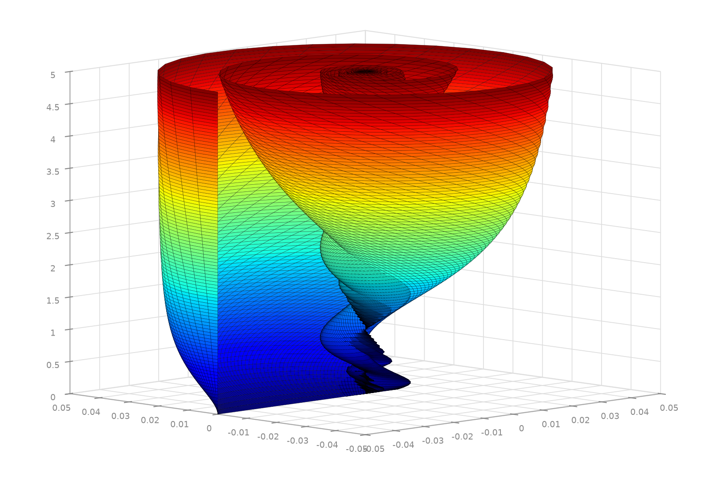
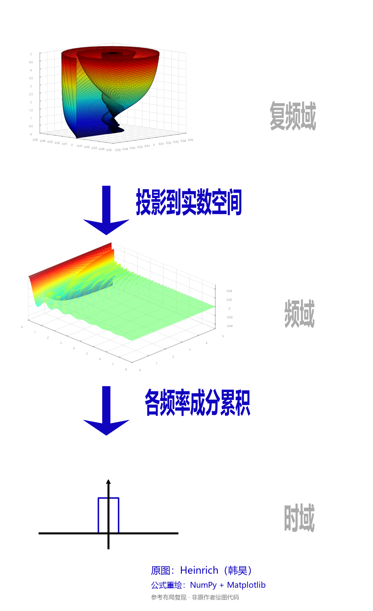
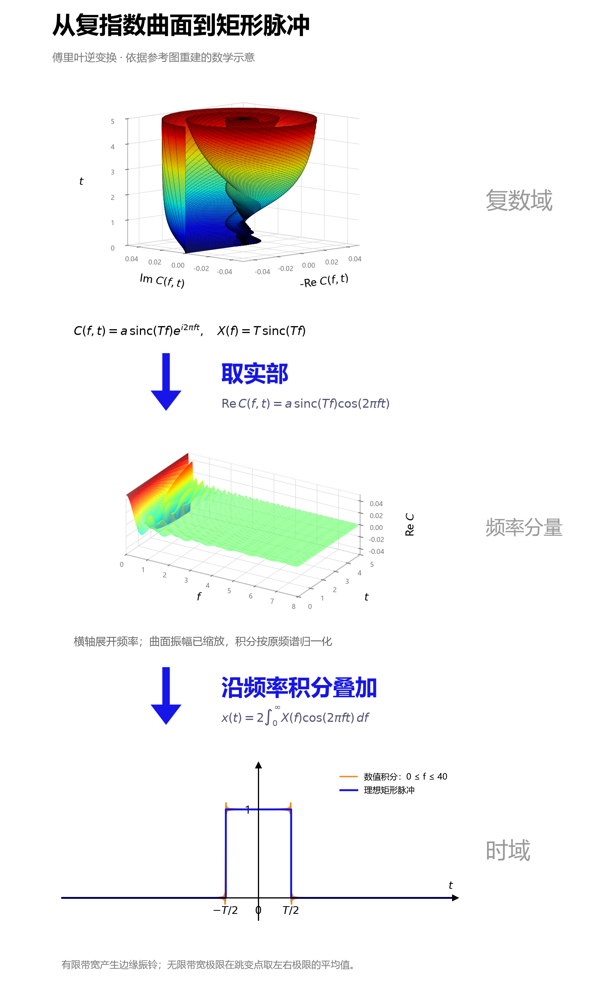
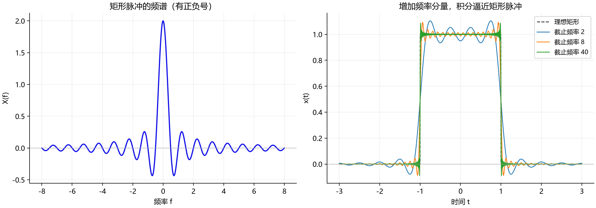

# 傅里叶“海螺图”：从复指数曲面到矩形脉冲

这份文档整理傅里叶“海螺图”的绘制原理与脚本复现，包括两个独立海螺曲面版本，以及“海螺曲面 → 各频率的余弦分量 → 矩形脉冲”的三层示意图。单图分别参考用户提供的[知乎文章](https://zhuanlan.zhihu.com/p/19763358)和 [CSDN 文章](https://blog.csdn.net/Ciellee/article/details/108304531)及截图；三层图参考[腾讯云文章](https://cloud.tencent.com/developer/article/1187502)及对应截图。原图署名 Heinrich（韩昊）。

复现使用 Python、NumPy 和 Matplotlib，曲面、箭头、文字和坐标均由代码绘制，运行时不读取截图，也不需要联网。视角、采样范围和布局按截图调整，属于数学与视觉重建，并非原作者代码或精确参数的恢复。

## 1. 复现结果

### 1.1 单张海螺截图


| 文件 | 内容 |
| --- | --- |
| [reproduce_single.py](reproduce_single.py) | 本次单图复现脚本，支持修改宽度、频率范围和视角 |
| [fourier_shell_single.png](output/single/fourier_shell_single.png) | 1600 × 1130 图片 |
| [fourier_shell_single.svg](output/single/fourier_shell_single.svg) | 矢量坐标文字，密集曲面为嵌入位图 |
| [parameters.json](output/single/parameters.json) | 公式、坐标顺序及全部运行参数 |

这张图的核心公式是：

$$
C(f,t)=0.05\,\operatorname{sinc}(2f)e^{i2\pi ft},
\qquad
(x_{\mathrm{plot}},y_{\mathrm{plot}},z_{\mathrm{plot}})
=(-\operatorname{Re}C,\operatorname{Im}C,t).
$$

其中 $f\in[0,8]$、$t\in[0,5]$，且 $\operatorname{sinc}(u)=\sin(\pi u)/(\pi u)$。固定频率得到一条螺旋线，把不同频率的螺旋线连成曲面，就形成海螺；颜色随时间从蓝变红。默认振幅 $a=0.05=sT$，对应脉冲宽度 $T=2$、显示缩放 $s=0.025$，推导见第 3、4 节。

脉冲宽度、视角和网格参数依据截图轮廓选取。知乎原页在复现时未能成功读取，因此这是一份可运行的数学与视觉重建，不声称恢复了原作者的精确参数。输出图未重绘原作者水印。

### 1.2 CSDN 海螺图重绘

本次所附的 CSDN 截图由 [redraw_conch.py](redraw_conch.py) 重绘。它保留了左侧展开的曲面、右侧向下收拢的螺旋、按高度变化的彩虹配色和细黑网格。



| 文件 | 内容 |
| --- | --- |
| [redraw_conch.py](redraw_conch.py) | 独立重绘脚本，支持调整网格、视角及交互旋转 |
| [conch.png](output/conch.png) | 1600 × 1130 图片 |
| [conch.svg](output/conch.svg) | 坐标和文字为矢量，密集曲面为嵌入位图 |

这一版使用的公式为：

$$
A(f)=a\operatorname{sinc}(Tf),\qquad
C(f,t)=A(f)e^{i2\pi ft},
$$

$$
(x_{\mathrm{plot}},y_{\mathrm{plot}},z_{\mathrm{plot}})
=(-\operatorname{Re}C,\operatorname{Im}C,t).
$$

默认 $a=0.05$、$T=2$、$f\in[0,8]$、$t\in[0,5]$。其他三个脚本的海螺曲面现在使用同一组默认值、坐标顺序和相机角度。显示坐标取负实部是为了匹配截图朝向，并没有改用负频率。

`--amplitude` 表示频谱在零频处的值 $A(0)=a$，也是最大的螺旋半径。若把 $A(f)$ 当作信号的实际频谱，它对应宽度为 $T$、高度为 $a/T$ 的中心矩形脉冲；默认高度为 $0.025$。与其余脚本的显示缩放约定对照时，有 $a=sT$，所以不能直接把 `--amplitude` 当成 `--scale`。

本次已读取 CSDN 原文，文中没有提供绘图源码、采样范围或相机参数。当前参数由截图调校得到，属于数学与视觉上的近似复现；脚本绘制的是各频率分量构成的曲面，没有在这里执行逆变换积分。

### 1.3 三层示意图



| 文件 | 内容 |
| --- | --- |
| [reproduce_reference.py](reproduce_reference.py) | 接近截图布局的独立绘图脚本 |
| [fourier_reference.png](output/reference/fourier_reference.png) | 1200 × 1960 图片 |
| [fourier_reference.svg](output/reference/fourier_reference.svg) | 矢量文字、箭头与脉冲，三维曲面为嵌入位图 |
| [reference_parameters.json](output/reference/reference_parameters.json) | 公式、参数、采样规模和数值积分结果 |

默认底图保留参考图的理想矩形形状。要查看实际有限带宽积分的结果，可以添加 `--show-reconstruction`，在底图叠加橙色重建曲线。

### 1.4 本次实际运行的带公式版本

运行 [reproduce.py](reproduce.py) 后得到下面这张图。上方绘制复指数形成的海螺曲面，中间取相同数据的实部，底部同时显示理想矩形脉冲（蓝线）和有限带宽积分结果（橙线）。因此，橙线边缘可见的振铃是计算结果，不是图片渲染错误。



脚本还生成频谱及不同截止频率的重建对照图：



这版使用 $T=2$、最大显示半径 $a=0.05$，曲面展示频率 $f\in[0,8]$、时间 $t\in[0,5]$；底图积分截止频率为 $F=40$。曲面和底图所需的频率范围不同，不能把中间曲面最右端的 8 当作底部积分上限。与第 1.3 节更接近原截图的排版版本相比，这版增加了公式和实际积分曲线，便于检查计算是否正确。

## 2. 运行方法

以下命令均在项目根目录 `D:\kSource\blog` 执行。

### 2.1 单张海螺图

安装依赖并运行：

```powershell
python -m pip install -r scripts/fourier_shell/requirements.txt
python scripts/fourier_shell/reproduce_single.py
```

当前工作区已有可用隔离环境，可直接执行：

```powershell
.\tempdir\fourier-shell-venv\Scripts\python.exe scripts/fourier_shell/reproduce_single.py
```

输出默认保存在 `scripts/fourier_shell/output/single/`。单图脚本只使用英文坐标文字，无需中文字体。默认省略坐标名称以接近截图，可用 `--labels` 显示虚部、实部和时间轴名称。

修改观察角度，并将结果另存到其他目录：

```powershell
.\tempdir\fourier-shell-venv\Scripts\python.exe scripts/fourier_shell/reproduce_single.py --elev 20 --azim 150 --labels --output tempdir/shell-other-view
```

### 2.2 CSDN 海螺图

安装本目录的依赖后运行：

```powershell
python -m pip install -r scripts/fourier_shell/requirements.txt
python scripts/fourier_shell/redraw_conch.py
```

当前工作区可直接使用已有环境：

```powershell
.\tempdir\fourier-shell-venv\Scripts\python.exe scripts/fourier_shell/redraw_conch.py
```

默认生成 `output/conch.png` 与 `output/conch.svg`。运行时不读取参考图片，不联网，也不需要中文字体。参数示例：

```powershell
# 改变卷曲外形、观察角度及导出分辨率
python scripts/fourier_shell/redraw_conch.py --width 2.5 --elev 12 --azim -125 --dpi 250

# 降低网格密度，保存后打开交互窗口，用鼠标旋转
python scripts/fourier_shell/redraw_conch.py --nf 601 --nt 81 --show --labels

# 指定 PNG 文件路径，同时生成同名 SVG
python scripts/fourier_shell/redraw_conch.py --output tempdir/my_conch.png

# 查看完整参数
python scripts/fourier_shell/redraw_conch.py --help
```

这里的 `--output` 接受以 `.png` 结尾的**文件路径**；其他几个脚本接受的是输出目录。默认运行仅保存文件，`--show` 需要本机具有可用的 Matplotlib 图形后端。

### 2.3 三层示意图

安装依赖并生成图片：

```powershell
python -m pip install -r scripts/fourier_shell/requirements.txt
python scripts/fourier_shell/reproduce_reference.py
```

当前工作区已有隔离环境，可直接运行：

```powershell
.\tempdir\fourier-shell-venv\Scripts\python.exe scripts/fourier_shell/reproduce_reference.py
```

依赖为 `numpy>=2.0`、`matplotlib>=3.9`，另需本机安装中文字体。脚本依次查找微软雅黑、黑体、Noto Sans CJK SC、宋体及 Arial Unicode MS；没有可用中文字体时会给出错误提示。

显示有限带宽重建曲线，并保存到另一个目录：

```powershell
.\tempdir\fourier-shell-venv\Scripts\python.exe scripts/fourier_shell/reproduce_reference.py --show-reconstruction --output scripts/fourier_shell/output/reference_integral
```

查看完整参数：

```powershell
python scripts/fourier_shell/reproduce_reference.py --help
```

### 2.4 运行带公式与数值验证的版本

在项目根目录运行：

```powershell
python -m pip install -r scripts/fourier_shell/requirements.txt
python scripts/fourier_shell/reproduce.py
```

当前工作区已有隔离环境，也可以直接运行：

```powershell
.\tempdir\fourier-shell-venv\Scripts\python.exe scripts/fourier_shell/reproduce.py
```

默认生成 [三层图 PNG](output/fourier_shell.png)、[三层图 SVG](output/fourier_shell.svg)、[频谱与重建对照图](output/fourier_validation.png)和[数值核对结果](output/numerical_check.json)。可用 `--width` 调整脉冲宽度，`--cutoff` 调整积分截止频率，`--dpi` 调整图片分辨率，`--output` 指定输出目录。图中的中文需要系统安装中文字体。

## 3. 数学起点：矩形脉冲与 sinc 频谱

设矩形脉冲的宽度为 $T$、高度为 1，中心位于 $t=0$：

$$
x(t)=
\begin{cases}
1, & |t|<T/2,\\
0, & |t|>T/2.
\end{cases}
$$

这里用以 Hz 为单位的频率 $f$，采用如下傅里叶变换约定：

$$
X(f)=\int_{-\infty}^{\infty}x(t)e^{-i2\pi ft}\,dt.
$$

对矩形区间积分，得到：

$$
X(f)=\int_{-T/2}^{T/2}e^{-i2\pi ft}\,dt
=\frac{\sin(\pi Tf)}{\pi f}
=T\,\operatorname{sinc}(Tf).
$$

其中使用 NumPy 的归一化定义：

$$
\operatorname{sinc}(u)=\frac{\sin(\pi u)}{\pi u},
\qquad \operatorname{sinc}(0)=1.
$$

因此代码中的 `np.sinc(width * f)` 已经包含分子中的 $\pi$，不需要再把输入乘以 $\pi$。频谱的负旁瓣必须保留符号；取绝对值会改变信号，无法按原关系恢复矩形脉冲。

## 4. 上层：海螺曲面是怎样形成的

把逆变换中的每个频率分量写为：

$$
C(f,t)=sX(f)e^{i2\pi ft},
$$

其中 $s=a/T$ 是绘图缩放系数，$a$ 是命令行参数 `--amplitude`，表示零频处的最大螺旋半径。`reproduce_single.py` 和 `reproduce_reference.py` 仍支持旧参数 `--scale`，传入时换算为 $a=sT$。展开实部和虚部：

$$
\operatorname{Re}C=sT\operatorname{sinc}(Tf)\cos(2\pi ft),
$$

$$
\operatorname{Im}C=sT\operatorname{sinc}(Tf)\sin(2\pi ft).
$$

固定一个频率 $f>0$，复数 $C(f,t)$ 随时间绕原点旋转：半径为 $s|X(f)|$，角速度为 $2\pi f$。把时间再作为第三个坐标，就得到一条螺旋线。$f=0$ 时不旋转，是直线；频谱零点处的螺旋退化到时间轴。

不同频率具有不同半径和转速。脚本把相邻时间、相邻频率的采样点连接成网格，形成海螺状的参数曲面。为了匹配截图的开口方向，采用：

$$
(x_{\mathrm{plot}},y_{\mathrm{plot}},z_{\mathrm{plot}})
=(-\operatorname{Re}C,\operatorname{Im}C,t).
$$

负实部与虚部的坐标顺序决定显示朝向。上图颜色按时间（高度）映射到 `jet` 色图：底部蓝、顶部红；颜色并不表示频率或幅值。

四个脚本的海螺曲面现在都采用 `redraw_conch.py` 的默认组合：$T=2$、$a=0.05$、$f\in[0,8]$、$t\in[0,5]$，采样网格为 101 个时间点乘 1201 个频率点，绘图步长均为 1。坐标均为 $(-\operatorname{Re}C,\operatorname{Im}C,t)$，三维框比例为 `(1, 1, 0.78)`，正交投影，仰角 $8^\circ$、方位角 $-135^\circ$。`reproduce_single.py` 与 `redraw_conch.py` 的独立单图使用相同画布和曲面样式；两个三层图因布局较窄，曲面占整张图的面积不同，但几何外形一致。中层曲面以 $(f,t,\operatorname{Re}C)$ 为坐标，仍使用适合其横向几何的视角。

主瓣形成外壳，衰减的旁瓣形成内部卷曲。必须保留 sinc 的负值，因为负号代表额外的 $\pi$ 相位；不能用 `abs(sinc(...))` 代替。$f=0$ 处也不能直接做除零运算，`np.sinc` 已正确处理其极限。

## 5. 中层：取实部并展开频率坐标

中图使用同一组复数采样，绘制：

$$
(x_{\mathrm{plot}},y_{\mathrm{plot}},z_{\mathrm{plot}})
=(f,t,\operatorname{Re}C(f,t)).
$$

固定频率后，沿时间方向看到的是一条余弦曲线：

$$
\operatorname{Re}C(f,t)=sX(f)\cos(2\pi ft).
$$

频率越大，曲线振荡越快；其振幅由 sinc 包络决定。中图颜色按曲面的高度，即实部值着色，与上图按时间着色的含义不同。

原图的“投影到实数空间”可以帮助理解取实部，但画出中图还需要把原先隐藏在曲面参数中的频率 $f$ 展开为坐标轴。因此，这一步不仅是把上图在原坐标系内压到某个平面。

为贴近截图，复现图沿用了“复频域 / 频域 / 时域”的文字。严格地说，上图是复指数频率分量的参数曲面，中图是各频率的时间波形集合；它们都不是通常意义上只依赖频率的频谱 $X(f)$，上图也不涉及拉普拉斯变换的复频率变量。

## 6. 下层：沿频率积分，恢复矩形脉冲

傅里叶逆变换为：

$$
x(t)=\int_{-\infty}^{\infty}X(f)e^{i2\pi ft}\,df.
$$

本例的频谱为实偶函数，正负频率分量的虚部相互抵消，因此可以写成：

$$
x(t)=2\int_0^{\infty}X(f)\cos(2\pi ft)\,df.
$$

数值计算只能积分到有限截止频率 $F$：

$$
x_F(t)=2\int_0^F T\operatorname{sinc}(Tf)\cos(2\pi ft)\,df.
$$

脚本使用梯形积分计算这个表达式。系数 2 包含负频率的贡献，不能省略。绘图缩放系数 $s$ 不参与此处的积分，所以重建脉冲的高度仍为 1；如果直接对图中的 $\operatorname{Re}C$ 积分，则应使用 $2/s$ 作为系数。

默认曲面只展示 $f\in[0,8]$，数值积分则使用 $f\in[0,40]$。前者用于看清形状，后者用于提高重建精度，两者的范围可以不同。曲面只展示非负时间，底图展示以零为中心的正负时间。

有限带宽会在矩形边缘产生 Gibbs 振铃。增大 $F$ 会使振铃区域变窄，但跳变附近的超调比例不会趋于零；在 $t=\pm T/2$ 处，逆变换的无限带宽极限为左右极限的平均值 $1/2$。因此默认底图中的笔直矩形边缘是理想示意，并非有限数值积分的实际结果。

## 7. 核心绘图代码

### 7.1 单张海螺图

下面是一个可以独立运行的最小例子。它保留单图的主要公式、配色和观察角度；完整脚本还包含坐标样式、画布布局、参数校验与 SVG 导出。

```python
import numpy as np
import matplotlib

matplotlib.use("Agg")
import matplotlib.pyplot as plt

f, t = np.meshgrid(
    np.linspace(0, 8, 1201),
    np.linspace(0, 5, 101),
)
c = 0.05 * np.sinc(2 * f) * np.exp(2j * np.pi * f * t)

fig = plt.figure(figsize=(8, 5.65))
ax = fig.add_subplot(projection="3d")
ax.plot_surface(
    -c.real, c.imag, t,
    cmap="jet", vmin=0, vmax=5,
    rstride=1, cstride=1,
    edgecolor=(0, 0, 0, 0.50), linewidth=0.25,
    shade=False,
)
ax.set(xlim=(-0.05, 0.05), ylim=(-0.05, 0.05), zlim=(0, 5))
ax.set_box_aspect((1, 1, 0.78))
ax.set_proj_type("ortho")
ax.view_init(elev=8, azim=-135)
fig.savefig("fourier_shell_minimal.png", dpi=200)
plt.close(fig)
```

`plot_surface` 将相邻频率与时间的采样点连接成网格。因为传入的第三个坐标是时间 `t`，`cmap="jet"` 按时间着色；`shade=False` 保留色图本身的颜色。

### 7.2 三层图中的两层曲面

下面是脚本中生成两层曲面的核心关系，完整排版、参数检查和导出逻辑见 [reproduce_reference.py](reproduce_reference.py)。

```python
import numpy as np

width = 2.0
amplitude = 0.05
f, t = np.meshgrid(
    np.linspace(0, 8, 1201),
    np.linspace(0, 5, 101),
)

c = amplitude * np.sinc(width * f) * np.exp(2j * np.pi * f * t)

# shell 和 waves 是 Matplotlib 的两个三维坐标轴。
shell.plot_surface(-c.real, c.imag, t, cmap="jet", rstride=1, cstride=1)
waves.plot_surface(f, t, c.real, cmap="jet")
```

海螺的形状来自 sinc 包络与复指数相位共同作用，不需要额外指定一个海螺几何模型。

## 8. 参数说明

### 8.1 四个脚本共用的曲面参数

共同默认值由 [redraw_conch.py](redraw_conch.py) 定义，其他脚本直接导入。它们的**上层海螺**使用相同的公式、数据网格、坐标方向、曲面比例和视角；三层图的中图因为坐标轴不同，单独选取横向视角。

| 参数 | 共同默认值 | 作用 |
| --- | --- | --- |
| `--width` | `2.0` | 矩形脉冲宽度 $T$，控制 sinc 包络 |
| `--amplitude` | `0.05` | 零频处的显示半径 $a$；等于 $sT$ |
| `--fmax` | `8.0` | 曲面展示的最高正频率，单位 Hz |
| `--tmax` | `5.0` | 曲面展示的时间上限 |
| `--nf` | `1201` | 频率方向采样点数 |
| `--nt` | `101` | 时间方向采样点数 |
| `--elev` | `8.0` | 海螺曲面相机仰角，单位度 |
| `--azim` | `-135.0` | 海螺曲面相机方位角，单位度 |
| `--dpi` | `200` | 图片导出分辨率 |

绘图框比例统一为 `(1, 1, 0.78)`，采用正交投影。`reproduce_single.py` 与 `reproduce_reference.py` 保留旧参数 `--duration`（等价于 `--tmax`），也保留 `--scale`（换算为 `--amplitude = --scale × --width`）；新命令建议直接使用与 `redraw_conch.py` 一致的名称。`--scale` 与 `--amplitude` 不能同时传入。

`--amplitude` 只控制展示的复平面坐标，三层图的积分使用未缩放的 $X(f)=T\operatorname{sinc}(Tf)$，因此单位高度的时域脉冲不变。如果直接积分展示数据 $C$，则应乘 $2/s=2T/a$ 才能还原单位高度。单图只绘制正频率分量，不执行积分。

增大最高频率或展示时长时，应相应提高 `--nf` 或 `--nt`，避免曲面网格欠采样。提高 DPI 只能增加导出像素，不能补充频率或时间采样。SVG 的密集曲面嵌入位图，坐标与文字保留矢量。

### 8.2 各脚本专有的参数和输出

| 脚本 | 其他参数及默认值 | 默认输出 |
| --- | --- | --- |
| [redraw_conch.py](redraw_conch.py) | `--labels`、`--show` 默认关闭；`--output` 接受 PNG 文件路径 | `output/conch.png` 和 `.svg` |
| [reproduce_single.py](reproduce_single.py) | `--labels` 默认关闭；`--output` 接受目录 | `output/single/` 中的 PNG、SVG、参数 JSON |
| [reproduce_reference.py](reproduce_reference.py) | `--cutoff 40`；`--show-reconstruction` 默认关闭；`--output` 接受目录 | `output/reference/` 中的 PNG、SVG、参数 JSON |
| [reproduce.py](reproduce.py) | `--cutoff 40`；`--output` 接受目录 | `output/` 中的 PNG、SVG、验证图、数值 JSON |

单图画布为 8 × 5.65 英寸；参考布局三层图为 6 × 9.8 英寸；带公式的三层图为 8 × 13 英寸。只有 `redraw_conch.py` 提供 `--show` 交互窗口。要把脉冲宽度从默认的 2 增加到 4，同时保持曲面的无量纲形状，可以把时间范围增加到 10、最高频率和积分截止频率各减半：

```powershell
python scripts/fourier_shell/reproduce_reference.py --width 4 --tmax 10 --fmax 4 --cutoff 20 --show-reconstruction --output scripts/fourier_shell/output/reference_width4
```

## 9. 数值检查

### 9.1 单图公式与导出

单图已实际运行，PNG 尺寸为 1600 × 1130。曲面坐标均为有限值，$f=0$ 的显示边界满足 $x_{\mathrm{plot}}=-0.05$、$y_{\mathrm{plot}}=0$，负 sinc 旁瓣的符号也被保留。单图与 `redraw_conch.py` 使用相同的默认曲面、相机和画布，所以两张 PNG 的像素内容一致。

为独立核对公式，对宽度为 2 的矩形脉冲在 $\tau\in[-1,1]$ 上使用 20001 个点做数值傅里叶积分，再与单图公式生成的复数分量比较。在 $f=0,0.13,0.25,0.5,0.75,1.25$ 及默认时间采样点上的最大绝对误差约为 $3.27\times10^{-10}$。这个检查验证数学计算，不代表与参考截图之间的像素误差。

现在还可以直接使用同一组参数名称调整四个脚本，例如 `--width 3 --amplitude 0.05 --fmax 6 --tmax 4 --nf 1201 --nt 101 --elev 8 --azim -135`。

### 9.2 CSDN 重绘版本

`redraw_conch.py` 已实际运行，生成了 1600 × 1130 的 PNG 和同名 SVG。默认曲面数组形状为 `101 × 1201`，检查内容包括：

- 所有坐标均为有限值，`np.sinc` 正确处理零频极限。
- $f=0$ 时，显示边界满足 $x_{\mathrm{plot}}=-0.05$、$y_{\mathrm{plot}}=0$。
- $t=0$ 时，所有分量的虚部均为零。
- 各频率分量满足 $x_{\mathrm{plot}}^2+y_{\mathrm{plot}}^2=A(f)^2$，即每条螺旋的半径不随时间变化。
- sinc 的负旁瓣保留符号。

这些检查验证公式和导出结果；与参考截图的接近程度通过观察轮廓、朝向、配色和网格判断，没有给出像素级误差指标。

### 9.3 三层图的有限带宽积分

默认 $T=2$、$F=40$ 的实际积分结果如下，完整数据见 [reference_parameters.json](output/reference/reference_parameters.json)。

| 时间 $t$ | 位置 | 数值积分 $x_F(t)$ | 无限带宽极限 |
| --- | --- | --- | --- |
| 0 | 脉冲中心 | 0.997467 | 1 |
| 0.5 | 脉冲内部 | 0.996623 | 1 |
| 1.0 | 跳变边缘 | 0.499367 | 0.5 |
| 1.5 | 脉冲外部 | 0.002026 | 0 |
| 2.0 | 脉冲外部 | 0.000845 | 0 |

已检查曲面模长是否等于 $s|X(f)|$、实部是否符合余弦表达式、积分归一化以及重建的偶对称性。上述五个采样点与无限带宽极限的最大误差小于 0.004；这只是指定采样点的检查，不代表边缘附近振铃的最大误差。

四个脚本的默认模式均已重新运行，参考布局图的 PNG 尺寸为 1200 × 1960。

带公式版本 `reproduce.py` 也已在本机实际运行。它独立输出的[数值核对文件](output/numerical_check.json)给出近乎相同的五个采样值；两个脚本的积分步长略有差异，因此最后几位小数不完全相同。已用时域矩形脉冲的数值正变换核对 sinc 公式，并检查逆变换的归一化、跳变点约为 $1/2$ 以及时域偶对称性。上述检查验证数学计算，图像外观仍是对参考图的近似重建。

## 10. 文件索引

| 脚本或文档 | 用途 |
| --- | --- |
| [reproduce.py](reproduce.py) | 本次运行的带公式三层图；输出结果见第 1.4 节，运行方法见第 2.4 节 |
| [reproduce_single.py](reproduce_single.py) | 单独绘制海螺曲面，说明见 [SINGLE_IMAGE.md](SINGLE_IMAGE.md) |
| [redraw_conch.py](redraw_conch.py) | 本次 CSDN 海螺图的单图版本，支持调整采样和交互旋转；效果见第 1.2 节，参数见第 8.2 节 |

四个脚本共用海螺曲面的默认参数；两种三层图对中层和底层使用不同的布局与标注。可用对应脚本的 `--help` 查看全部参数。

## 参考资料

- [Ciellee：傅里叶变换解析（CSDN）](https://blog.csdn.net/Ciellee/article/details/108304531)：本次海螺截图的来源，文中说明了不同频率螺旋构成曲面的思路，未提供绘图源码和具体参数。
- [用户提供的腾讯云文章](https://cloud.tencent.com/developer/article/1187502)：图示参考；本次网页读取未成功，以用户附图为主要视觉依据。
- [Heinrich：傅里叶分析之掐死教程](https://zhuanlan.zhihu.com/p/19763358)：原图相关教程来源链接。
- [MathWorks：Fourier Transform](https://www.mathworks.com/help/symbolic/sym.fourier.html)：矩形脉冲傅里叶变换示例。该文档默认使用角频率 $\omega$，与本文的关系为 $\omega=2\pi f$。
- [Matplotlib：3D surface](https://matplotlib.org/stable/gallery/mplot3d/surface3d.html)：三维曲面与色图绘制接口。
- [仓库中的傅里叶变换笔记](../../_posts/dip/2020-09-26-dip-fourier-transform.md)。
